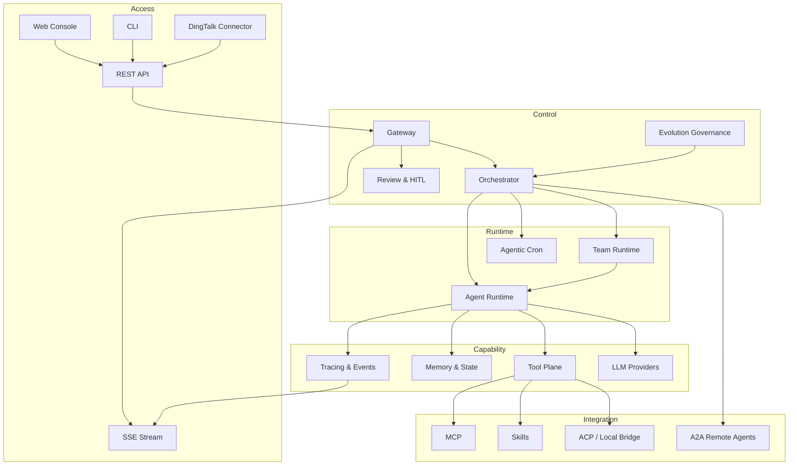

# Axon SPEC

> 状态：Legacy reference
> 版本：2026-03-26
> 适用范围：旧 `v1 foundation` 技术规范
> 说明：本文档基于旧的 `v1 foundation` 方案撰写。当前新的 `v0` 开发不再以本文档为直接实现依据，仅作为历史参考。当前入口请先看 `docs/README.md`。
> 上游产品文档：[PRD.md](./PRD.md)
> 参考资料：[`docs/archive/v1-old/00-overview.md`](./archive/v1-old/00-overview.md)、[`docs/archive/v1-old/01-agent-core.md`](./archive/v1-old/01-agent-core.md)、[`docs/archive/v1-old/02-orchestrator.md`](./archive/v1-old/02-orchestrator.md)、[`docs/archive/v1-old/03-team.md`](./archive/v1-old/03-team.md)、[`docs/archive/v1-old/04-tools-skills.md`](./archive/v1-old/04-tools-skills.md)、[`docs/archive/v1-old/05-memory-tracing.md`](./archive/v1-old/05-memory-tracing.md)、[`docs/archive/v1-old/06-gateway-api.md`](./archive/v1-old/06-gateway-api.md)、[`docs/axon-v1-process.md`](./axon-v1-process.md)

---

## 1. 文档目的

本文档定义 Axon `v1 foundation` 的实现边界、系统架构、模块职责、数据与接口约束、非功能要求和交付优先级。

本文档的重点不是描述终局产品，而是明确：

- `v1` 实际要构建什么
- `v1` 不做什么
- 现有代码已经具备哪些基础
- 哪些能力仍需补齐

---

## 2. v1 Foundation 定义

### 2.1 目标

Axon `v1 foundation` 需要交付一个可实际使用的、自托管单实例 Agent 系统基座，满足以下条件：

- Web-first，CLI 为辅
- 面向个人或小团队共享使用
- 以任务为中心，而不是聊天为中心
- 支持单 Agent 与多 Agent 协作
- 支持长期任务、事件追踪、人工干预、任务恢复
- 支持通过 A2A 扩展远程 Agent 协作
- 支持通过 ACP / 本地桥接调用本地外部 Agent 工具
- 支持钉钉作为首个正式渠道
- 支持审核后生效的自进化能力

### 2.2 非目标

以下明确不属于 `v1 foundation` 的必须交付内容：

- 多租户 SaaS
- 大型组织级权限体系
- 完整插件市场
- 多模态完整闭环
- 无审核的自治自我修改
- 全量渠道接入矩阵
- 企业级部署编排与商业化能力

---

## 3. 当前实现基线

本节用于区分“已经有基础”和“仍属于目标设计”。

### 3.1 已存在的实现基础

根据当前代码与文档，仓库内已具备以下基础能力：

- `cmd/axon`
  - `chat` 模式
  - `server` 模式
- `internal/agent`
  - 单 Agent ReAct Loop
  - 基础状态处理
  - `SOUL.md` 解析
- `internal/orchestrator`
  - 单任务运行入口
  - 团队任务入口
- `internal/team`
  - 团队创建
  - DAG 任务执行基础
- `internal/memory`
  - In-memory store
  - SQLite store 基础
  - BM25 fallback 的记忆搜索雏形
- `internal/tracing`
  - In-memory tracing
  - Trace/Span 生成与获取
- `internal/hitl`
  - 内存态 HITL ticket 管理
- `internal/gateway`
  - REST API 基础
  - SSE 事件流基础
- `internal/tools`
  - Tool registry
  - Native file/shell/web search/code exec 基础
  - MCP client 基础
  - Skills parser/runner 基础
- `internal/cron`
  - Agentic Cron 基础调度器

### 3.2 已识别的缺口

当前实现与 `v1 foundation` 目标之间仍存在明显缺口：

- Web UI 仅有 `web/dist` 占位，尚未形成正式 Web-first 控制台
- 任务、Agent、HITL、Trace 的持久化数据模型未完整落地
- 权限治理和安全边界仍偏薄
- 团队路由和多 Agent 分工还不够产品化
- A2A 尚未实现正式适配层
- ACP / 本地外部 Agent 桥接尚未实现正式适配层
- 钉钉渠道尚未落地
- 自进化建议与审核发布链路尚未落地
- API 和事件模型还未统一为稳定契约

结论：

> `v1 foundation` 不应被描述为“从零开始”，但也不能被描述为“已完成大部分产品能力”。当前更准确的表述是：已有核心运行时雏形，需要补齐控制面、持久化、适配层和治理能力。

---

## 4. 系统范围

### 4.1 `v1` 内系统组成

`v1 foundation` 包含以下一级模块：

1. Gateway / Control Plane
2. Web Console
3. Orchestrator
4. Agent Runtime
5. Team Runtime
6. Tool Plane
7. Memory & State
8. Tracing & Event Stream
9. HITL & Review
10. Channel Connector
11. External Agent Integration
12. Evolution Governance

### 4.2 系统边界

- Axon 负责控制平面、编排、状态、审计、追踪和本地执行治理
- 远程 Agent 不属于 Axon 内部运行时，但可通过 A2A 纳入协作网络
- 本机外部 Agent 工具不属于 Axon 内核，但可通过 ACP / CLI bridge 被发现和调度
- 钉钉是渠道连接器，而不是主控制平面

---

## 5. 关键架构原则

### 5.1 Control Plane 与 Execution Plane 分离

Web、REST、SSE、钉钉通知属于控制平面。
Agent 推理、工具执行、外部 Agent 委派属于执行平面。

### 5.2 Interface First

下列能力必须坚持接口抽象：

- LLM provider
- Memory store
- Vector store
- Tool registry / tool executor
- Channel connector
- External agent adapter
- Evolution policy provider

### 5.3 Local-first, Self-host-friendly

`v1` 默认围绕本地或自托管单实例设计：

- SQLite 优先
- 单工作区优先
- 少依赖外部基础设施
- 默认可离线保存关键状态

### 5.4 Observable by default

任务、步骤、工具调用、Agent 分工、外部委派、审核节点必须具备结构化事件和可追踪标识。

### 5.5 Governed autonomy

系统允许自治执行，但关键动作必须可中断、可审核、可回滚、可归因。

---

## 6. 部署模型

### 6.1 v1 默认部署

`v1 foundation` 默认部署形态：

- 单个 Axon 实例
- 单个共享工作区
- 单个 SQLite 主数据存储
- 通过浏览器访问 Web 控制台
- 可选绑定钉钉回调与通知

### 6.2 运行模式

- `server`：主运行模式，承载 Web/API/SSE/调度
- `chat`：辅助调试模式，用于开发调试与运维

### 6.3 进程模型

推荐单进程承载以下组件：

- Gateway
- Orchestrator
- Event bus
- Agent runtime
- Team runtime
- HITL manager
- Cron scheduler
- Channel connectors

后续若要拆分，也必须保留统一任务 ID、Trace ID 和事件契约。

---

## 7. 顶层架构



---

## 8. 模块规范

### 8.1 Gateway / Control Plane

### 职责

- 提供统一 API 入口
- 维护任务、Agent、审核与追踪查询接口
- 将外部入口统一转换为内部任务模型
- 暴露 SSE 实时事件流

### 输入

- Web 请求
- CLI 请求
- 钉钉 webhook / callback
- 内部调度事件

### 输出

- Task submission
- HITL / review actions
- Event stream
- Query APIs

### v1 要求

- REST API 统一放在 `/api/*`
- SSE 统一放在 `/events` 或 `/api/events`
- 所有入口先落到统一的任务提交模型，再进入编排层

### 8.2 Web Console

### 角色

Web 是 `v1` 主入口和主控制台。

### 必备页面

- 任务列表
- 任务详情
- Trace / Event 时间线或调用树
- HITL / 审核面板
- Agent / Team 状态视图
- 配置与连接器管理
- Evolution 建议审核页

### v1 要求

- 不依赖 CLI 完成主要任务流
- 首次启动后即可进入基本控制面
- 与 SSE 联动展示实时状态

### 8.3 Orchestrator

### 职责

- 接收统一任务请求
- 判断单 Agent、团队、Cron、外部委派等处理模式
- 维护任务状态机
- 负责上下文装配和执行发起

### v1 路由模式

- `single`
- `team`
- `scheduled`
- `external_delegated`

### 路由决策输入

- 用户目标
- 来源入口
- 任务复杂度
- 所需角色 / 工具能力
- 预算和安全级别

### v1 约束

- 路由结果必须可记录、可解释
- 一次任务只能有一个主 Trace ID
- 所有子任务必须关联父任务或父 Span

### 8.4 Agent Runtime

### 职责

- 承载 ReAct Loop
- 管理局部上下文
- 调用工具、Skills、外部适配器
- 执行失败重试
- 触发 HITL

### v1 约束

- 必须有 `max_steps` 与失败阈值
- 必须记录工具调用和步骤事件
- 必须支持 suspend / resume
- 必须支持可控的上下文压缩

### 8.5 Team Runtime

### 职责

- 组装多 Agent 团队
- 按任务依赖执行 DAG
- 管理中间结果传递
- 聚合团队结果

### v1 团队模型

- 角色型 team，例如 Architect / Coder / Reviewer
- 任务依赖型 DAG 执行
- 子任务结果摘要注入上游或下游上下文

### v1 约束

- 结果传递要结构化，而不是全量推理透传
- 团队执行必须可追踪到 Agent、Task、Span
- 团队失败必须能停在具体子任务上

### 8.6 Tool Plane

### 组成

- Native tools
- MCP adapters
- Skills engine
- Browser / web automation
- External local bridge

### v1 Native 工具最小集合

- 文件读写与列举
- shell 执行
- web search
- 基础 HTTP 请求
- 可控代码执行

### v1 约束

- 所有工具调用统一经 Tool Registry
- 所有高风险工具必须支持审批门控
- 文件与 shell 执行必须受 workspace 限制

### 8.7 Memory & State

### 职责

- 保存任务、会话、消息、摘要、记忆片段、审核记录、建议记录
- 支撑恢复、追踪和复盘

### v1 存储原则

- SQLite 为主
- 内存结构只作为运行时缓存
- 长期状态必须可持久化

### v1 最小数据域

- tasks
- task_runs
- agents
- teams
- messages
- memory_fragments
- spans
- hitl_tickets
- channel_sessions
- external_agent_runs
- evolution_suggestions

### 8.8 Tracing & Event Stream

### 职责

- 为任务、步骤、工具调用、外部委派、审核节点生成统一事件
- 支撑 Web 实时展示和历史查询

### v1 事件原则

- 每个任务拥有 Trace ID
- 每个步骤拥有 Span ID
- 每个事件可关联 task_id、agent_id、team_id、channel_source

### 建议事件类型

- `task.created`
- `task.started`
- `task.blocked`
- `task.completed`
- `task.failed`
- `agent.step.started`
- `agent.step.completed`
- `tool.call.started`
- `tool.call.completed`
- `tool.call.failed`
- `external.run.started`
- `external.run.completed`
- `hitl.requested`
- `hitl.responded`
- `evolution.suggested`
- `evolution.approved`
- `evolution.rejected`

### 8.9 HITL & Review

### 职责

- 处理高风险确认
- 处理执行失败恢复
- 处理自进化建议审核
- 处理外部 Agent 委派审批

### v1 触发条件

- 连续工具失败达到阈值
- 高风险工具调用
- 外部委派需要确认
- 自进化建议待审批
- 渠道消息语义不确定或身份映射异常

### v1 约束

- 每个审核项都要有上下文快照
- 必须有状态：`pending`、`approved`、`rejected`、`dismissed`
- 审核动作必须被审计

### 8.10 Channel Connector

### v1 首个正式连接器

- 钉钉

### 职责

- 接收消息
- 校验来源
- 映射用户与会话
- 把消息转换为内部任务请求或任务补充输入
- 把状态和结果推送回渠道

### v1 渠道策略

- 钉钉承载轻交互、提醒和任务触发
- 复杂任务追踪、审核和配置统一回到 Web 完成

### 8.11 External Agent Integration

### 两条接入线

#### A2A

用于远程 Agent 与 Axon 的协作通信，适用于：

- 远端独立运行的 Agent 节点
- 不在本机进程内的团队成员 Agent
- 需要持续状态同步的远程协作

#### ACP / Local Bridge

用于本机发现和调用已存在的 Agent 工具，适用于：

- `claude-code`
- `codex`
- `opencode`
- 后续其他本地 Agent CLI

### v1 约束

- 外部适配器统一抽象为 `ExternalAgentAdapter`
- 无论通过 A2A 还是 ACP/CLI bridge，结果都要归一成统一运行记录
- 外部执行必须绑定隔离工作区和任务上下文

### 8.12 Evolution Governance

### 职责

- 读取任务结果、失败原因、审核意见和反馈
- 生成模板、路由、Skill 组合或 Agent 配置优化建议
- 提交审核
- 审核通过后生效

### v1 不允许

- 自动修改核心代码并直接生效
- 未审计地改写角色约束和高风险权限

---

## 9. 核心数据模型

本节只定义 `v1` 的概念模型，不展开完整 SQL schema。

### 9.1 Task

```txt
Task
- id
- source
- title
- description
- mode
- status
- trace_id
- created_by
- created_at
- updated_at
```

### 9.2 TaskRun

```txt
TaskRun
- id
- task_id
- runner_type
- status
- result_summary
- started_at
- finished_at
```

### 9.3 Agent

```txt
Agent
- id
- role
- soul_ref
- state
- trace_id
- parent_agent_id
- workspace_path
```

### 9.4 Team

```txt
Team
- id
- goal
- state
- trace_id
- created_at
```

### 9.5 HITLTicket

```txt
HITLTicket
- id
- type
- task_id
- agent_id
- status
- reason
- context_snapshot
- created_at
- resolved_at
```

### 9.6 ExternalAgentRun

```txt
ExternalAgentRun
- id
- task_id
- adapter_type
- target_name
- workspace_path
- status
- result_summary
- artifact_refs
```

### 9.7 EvolutionSuggestion

```txt
EvolutionSuggestion
- id
- target_type
- target_ref
- suggestion_type
- rationale
- proposed_change
- status
- reviewer
- applied_at
```

### 9.8 ChannelSession

```txt
ChannelSession
- id
- channel_type
- external_user_id
- external_chat_id
- mapped_task_id
- mapped_identity
- updated_at
```

---

## 10. 任务生命周期

### 10.1 主状态

```txt
pending -> running -> blocked -> resumed -> completed
pending -> running -> failed
pending -> cancelled
blocked -> rejected
```

### 10.2 生命周期说明

- `pending`
  任务已创建，尚未开始执行
- `running`
  编排和执行已启动
- `blocked`
  因 HITL、外部依赖、审批、渠道确认等原因暂停
- `resumed`
  从阻塞态恢复
- `completed`
  任务已完成
- `failed`
  任务失败并终止
- `cancelled`
  被主动取消
- `rejected`
  因审核拒绝而结束

### 10.3 v1 要求

- 所有状态转移必须发事件
- 阻塞态必须记录原因和恢复入口
- 恢复后保留完整历史，不覆盖之前状态

---

## 11. 交互与接口规范

### 11.1 Web/API

### 最小 API 集

- `POST /api/tasks`
- `GET /api/tasks`
- `GET /api/tasks/{id}`
- `GET /api/tasks/{id}/events`
- `GET /api/tasks/{id}/trace`
- `GET /api/hitl`
- `POST /api/hitl/{id}/approve`
- `POST /api/hitl/{id}/reject`
- `POST /api/hitl/{id}/respond`
- `GET /api/agents`
- `GET /api/teams`
- `GET /api/evolution/suggestions`
- `POST /api/evolution/{id}/approve`
- `POST /api/evolution/{id}/reject`
- `GET /api/connectors`
- `POST /api/connectors/dingtalk/test`

### 原则

- 统一资源风格
- 统一错误结构
- 统一 trace/task 标识返回

### 11.2 SSE

### 订阅方式

- 按 task
- 按 trace
- 按全局事件流

### v1 原则

- 支持断线重连
- 事件顺序至少在单任务内保持可解释
- 对 Web 控制台足够实时

### 11.3 钉钉连接器

### 输入

- 用户消息
- 群消息
- 回调事件

### 输出

- 任务创建确认
- 任务状态变化通知
- 审核提醒
- 结果摘要

### v1 原则

- 渠道只承载适合消息流的交互
- 大量结构化信息仍回到 Web 查看

### 11.4 A2A

### v1 最小能力

- 远程 Agent 注册或静态配置
- 任务委派
- 状态查询
- 结果回传
- 超时与失败处理

### v1 不要求

- 完整自治 mesh 网络
- 复杂跨实例调度策略

### 11.5 ACP / Local Bridge

### v1 最小能力

- 工具发现
- 命令发起
- 输出采集
- 产出物归档
- 运行超时控制

---

## 12. 配置与身份装配

### 12.1 角色定义

`v1` 继续采用 `SOUL.md` 作为角色定义的核心来源。

### 12.2 预留身份装配

后续需要形成统一装配模型：

- `AGENTS.md`
- `SOUL.md`
- `IDENTITY.md`
- `USER.md`
- `MEMORY.md`
- 技能摘要

### 12.3 v1 约束

在完整身份装配规范未定稿前：

- `SOUL.md` 是唯一正式角色装配输入
- 其它文档只作为未来扩展概念，不写进当前代码契约

---

## 13. 安全与治理约束

### 13.1 工作区隔离

- 文件工具只能访问受控工作区
- 外部 Agent 运行必须绑定独立目录
- 渠道输入不得直接映射为任意 shell 执行

### 13.2 高风险操作

以下默认需要审批或强约束：

- shell 执行
- 文件删除 / 覆盖
- 外部 Agent 委派
- 自进化建议生效
- 高权限连接器操作

### 13.3 注入边界

高优先级指令注入不能绕过：

- 工具白名单
- 角色约束
- 工作区边界
- 审核门槛

---

## 14. 可观测性要求

### 14.1 最低可观测要求

- 每个任务有 Trace ID
- 每个关键步骤有 Span ID
- 工具调用可定位输入、输出、耗时和错误
- 外部 Agent 委派可定位目标、状态和结果
- 审核动作有操作人和时间

### 14.2 Web 视图要求

Web 至少应能展示：

- 当前状态
- 执行时间线
- Agent / Team 视图
- 关键产出物
- 阻塞原因
- 审核入口

---

## 15. 性能与可靠性要求

### 15.1 性能目标

- 单实例下支持多个任务并行执行
- Web 控制台应能实时看到关键状态变化
- 大多数事件推送应在秒级内可见

### 15.2 可靠性要求

- 任务状态可持久化
- 关键审核项不可丢失
- 进程重启后可恢复至少部分任务上下文与记录
- 长任务不能依赖单纯内存态结构

### 15.3 扩展性要求

- 新增工具、连接器、外部 Agent 适配器时不应改写核心编排逻辑
- 存储后端和 LLM provider 可替换

---

## 16. v1 交付优先级

### P0

- 统一任务模型和持久化状态
- Web 主控制台基础页
- 统一事件模型与 SSE
- HITL / review 正式化
- 团队执行与结果聚合增强
- SQLite 持久化补齐
- 钉钉连接器基础可用

### P1

- A2A 远程 Agent 最小适配
- ACP / 本地桥接最小适配
- Evolution suggestion + approval 流程
- 更完整的权限和审批策略

### P2

- 更丰富 Web 运维与配置页
- 更多渠道和外部 Agent 适配
- 更强的策略优化和学习能力

---

## 17. 验收标准

当以下条件成立时，可认为 `v1 foundation` 达到可验收状态：

1. 用户可通过 Web 提交任务、查看状态、处理审核、查看结果
2. CLI 仍可用于调试和辅助操作，但不是完成主流程的必需
3. 单 Agent 与团队模式均可运行，并被统一追踪
4. 关键任务、事件、审核记录可持久化
5. 钉钉可完成至少一个真实任务触发和通知闭环
6. 系统可接入至少一种远程 Agent 协作路径和至少一种本地外部 Agent 桥接路径
7. 自进化建议可以生成、审核、通过后生效
8. 高风险操作和失败恢复有明确 HITL 机制

---

## 18. 与历史设计文档关系

- `docs/archive/v1-old/00-overview.md` 及其分册继续保留，作为专题设计说明
- 本 SPEC 是 `v1 foundation` 的主规范，优先级高于旧草稿叙事
- 若专题分册与本 SPEC 冲突，以本 SPEC 为准
- 后续新增详细技术文档应从本 SPEC 派生，而不是重新回到旧草稿分叉

---

## 19. 需重点审核的问题

本 SPEC 建议重点审核：

- `v1` 范围是否足够克制而不失去产品价值
- 当前实现基线与目标缺口的描述是否准确
- A2A 与 ACP / Local Bridge 的职责切分是否清晰
- 钉钉在 `v1` 中作为正式渠道的地位是否表述合理
- Evolution Governance 的“审核后生效”是否足够明确
- 模块划分是否适合后续继续拆成专题文档
