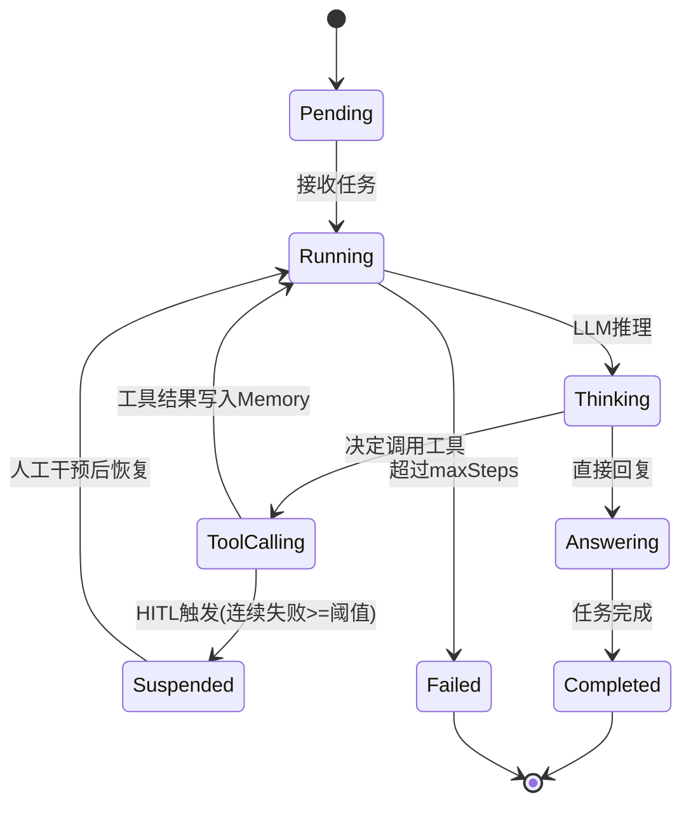
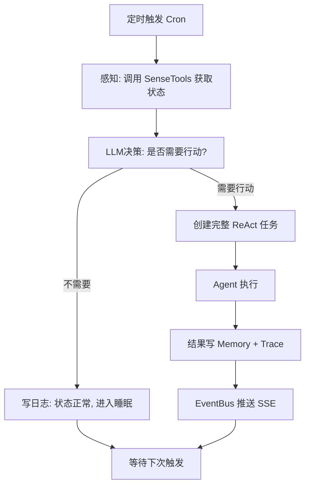

# Agent Core 设计

> 状态：Legacy reference
> 说明：本文档基于旧 `v1 foundation` 假设撰写，当前仅作为历史参考。新的 `v0` 主线请先看 `docs/README.md`。

> 所属层级：编排层 | 相关文档：[架构总纲](./00-overview.md) | [Orchestrator](./02-orchestrator.md)

> 注：本文档描述的是 Suag 长期演进中的 Agent Core 蓝图。当前已经落地、可独立嵌入使用的最小实现，请优先参考 [`pkg/agentcore/README.md`](../../../pkg/agentcore/README.md)、[`pkg/agentcore/docs/README.md`](../../../pkg/agentcore/docs/README.md) 与对应包文档。

---

## 1. 12步递进式实现机制

Agent Core 的构建遵循从简单到复杂的叠加策略：每个步骤在上一步基础上叠加一个机制，不推翻已有结构。这 12 步也是 suag 单 Agent 能力演进的路线图。

| 步骤 | 格言 | 叠加机制 | 说明 |
|------|------|----------|------|
| s01 | **"One loop & Bash is all you need"** | 最小 ReAct Loop | 一个工具 + 一个 for 循环 = 一个可用的智能体 |
| s02 | **"加一个工具, 只加一个 handler"** | 工具 dispatch map | 循环结构不变，新工具注册进 dispatch map 即可扩展 |
| s03 | **"没有计划的 agent 走哪算哪"** | Planner 步骤列表 | 执行前先输出步骤计划，完成率显著提升 |
| s04 | **"大任务拆小, 每个小任务干净的上下文"** | Subagent 隔离会话 | 子智能体使用独立 `messages[]`，不污染主对话上下文 |
| s05 | **"用到什么知识, 临时加载什么知识"** | tool_result 注入记忆 | 通过 tool_result 按需注入上下文，不塞 system prompt |
| s06 | **"上下文总会满, 要有办法腾地方"** | 三层压缩策略 | 摘要压缩 + 滑动窗口 + 记忆分片，换来无限长会话 |
| s07 | **"大目标要拆成小任务, 排好序, 记在磁盘上"** | 文件持久化任务图 | 任务 DAG 持久化到磁盘，为多 Agent 协作奠定基础 |
| s08 | **"慢操作丢后台, agent 继续想下一步"** | 后台异步执行 | 后台 goroutine 跑慢操作，完成后通过 channel 注入通知 |
| s09 | **"任务太大一个人干不完, 要能分给队友"** | 持久化队友 + 异步邮箱 | Agent 可以创建子 Agent，通过持久化消息队列通信 |
| s10 | **"队友之间要有统一的沟通规矩"** | request-response 协议 | 一个统一的 request-response 模式驱动所有 Agent 间协商 |
| s11 | **"队友自己看看板, 有活就认领"** | 自组织任务认领 | Agent 主动扫描任务看板，无需领导逐个分配，实现自组织 |
| s12 | **"各干各的目录, 互不干扰"** | worktree 隔离 | 任务 ID 与 worktree 目录绑定，文件操作域完全隔离 |

---

## 2. ReAct Loop 核心实现

### 2.1 执行逻辑

```
每一步循环：
  1. 从 Memory 检索相关历史 → 构建 context
  2. 调用 LLM（含工具 Schema）→ 获取响应
  3. 若有 ToolCall → 执行工具 → 结果写 Memory + Trace
  4. 若无 ToolCall → 判断是否完成（IsComplete）
  5. 工具执行失败计数 → 达阈值触发 HITL
  6. 每步记录 Span（TraceID/SpanID 传递）
```

### 2.2 核心接口

```go
type AgentRunner interface {
    Run(ctx context.Context, task *Task) (*TaskResult, error)
    Suspend(reason string) error
    Resume(instruction string) error
    Fork(ctx context.Context) (*AgentRunner, error)   // 会话分叉
    GetState() AgentState
}

type ReactLoop struct {
    agent    *Agent
    maxSteps int
    tracer   Tracer
    hitl     HITLManager
    eventBus EventBus
}
```

### 2.3 伪代码骨架

```go
func (a *Agent) Run(ctx context.Context, task string) error {
    a.memory.AddMessage("user", task)

    for step := 0; step < a.maxSteps; step++ {
        resp, err := a.llm.CompleteWithRetry(ctx, a.memory.GetContext())
        if err != nil {
            return err
        }

        if resp.ToolCall != nil {
            result, err := a.tools.Execute(ctx, resp.ToolCall)
            if err != nil {
                a.failCount++
                if a.failCount >= a.hitlThreshold {
                    return a.triggerHITL(ctx, resp.ToolCall, err)
                }
                a.memory.AddMessage("tool", "error: "+err.Error())
                continue
            }
            a.failCount = 0
            a.memory.AddMessage("tool", result)
            a.tracer.RecordToolCall(resp.ToolCall, result)
            continue
        }

        a.memory.AddMessage("assistant", resp.Content)
        if resp.IsComplete {
            return nil
        }
    }
    return errors.New("max steps reached")
}
```

---

## 3. 状态机

### 3.1 Agent 状态定义

```go
type AgentState string

const (
    AgentPending    AgentState = "pending"
    AgentRunning    AgentState = "running"
    AgentSuspended  AgentState = "suspended"  // HITL 挂起
    AgentCompleted  AgentState = "completed"
    AgentFailed     AgentState = "failed"
)
```

### 3.2 状态转移图



---

## 4. Agent 数据模型

```go
type Agent struct {
    ID          string
    Name        string
    Soul        *Soul         // SOUL.md 解析结果
    State       AgentState
    Memory      MemoryStore
    Tools       []Tool
    LLM         LLMProvider
    ParentID    string        // 上级 Agent ID（subagent 用）
    TraceID     string
    SpanID      string
    FailCount   int
    HITLThreshold int         // 默认 3
    MaxSteps    int
    CreatedAt   time.Time
    // 会话生命周期
    SessionID   string
    ForkOf      string        // 若为 fork 分叉，记录原始 SessionID
}
```

---

## 5. 会话生命周期：resume / fork

### 5.1 Resume（会话恢复）

当 Agent 因 HITL 挂起或进程重启，需从上次状态恢复：

- Agent 状态（含 FailCount、步骤序号）持久化到 SQLite
- Memory 消息列表持久化，恢复时重新加载
- 通过 `AgentRunner.Resume(instruction)` 注入人工指令后继续

```
[Agent Suspended]
    → 人工在 HITL 面板输入指令
    → POST /api/hitl/{ticket_id}/respond
    → HITLManager.Respond() 写入 channel
    → AgentRunner 从 WaitForResponse() 返回
    → State = Running, FailCount = 0
    → 继续 ReAct Loop
```

### 5.2 Fork（会话分叉）

Fork 用于：从某个会话节点创建分支实验、并行探索不同策略：

- 从当前 Agent 快照（Memory + State）克隆出新 Agent
- Fork Agent 持有 `ForkOf = 原始 SessionID`
- Fork Agent 在独立 goroutine 中运行，结果互不影响
- Fork 结果可通过 TraceID 在 WebUI 对比

```go
forkAgent, err := runner.Fork(ctx)
// forkAgent 拥有与原 Agent 相同的 Memory 快照
// 后续各自独立推进
```

---

## 6. 上下文压缩三层策略（s06）

当消息列表超出 token 预算时，依次执行：

| 层级 | 策略 | 触发条件 |
|------|------|----------|
| L1 | 滑动窗口：仅保留最近 N 条消息 | 消息数 > 阈值 |
| L2 | LLM 摘要压缩：将旧消息摘要为 1 条系统消息 | token 数 > 预算 70% |
| L3 | 重要性过滤：只保留 tool_call + 关键结论消息 | token 数 > 预算 90% |

压缩后的摘要存入 Memory fragments 表，可被向量检索召回。

详细 Memory 实现见 [Memory & Tracing 设计](./05-memory-tracing.md)。

---

## 7. 后台异步执行（s08）

慢操作（如 shell_exec、外部 Agent 调用）不阻塞主 ReAct Loop：

```go
// 启动后台任务
bgCh := make(chan ToolResult, 1)
go func() {
    result, err := tool.Execute(ctx, args)
    bgCh <- ToolResult{Result: result, Err: err}
}()

// 主 Loop 继续推进其他决策
// 当 LLM 下一步需要结果时，从 channel 读取
select {
case r := <-bgCh:
    memory.AddMessage("tool", r.Result)
case <-ctx.Done():
    return ctx.Err()
}
```

---

## 8. Agentic Cron

智能定时任务具备"感知 → 决策 → 执行"三阶段自主判断：



```go
type CronJob struct {
    ID             string
    Name           string
    Schedule       string          // cron 表达式
    SenseTools     []string        // 感知阶段工具列表
    DecisionPrompt string          // 决策 prompt 模板
    AgentConfig    *AgentConfig    // 执行阶段 Agent 配置
    LastRunAt      time.Time
    LastResult     string
}
```
