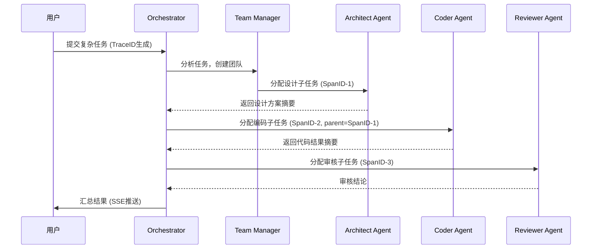

# Team 协作设计

> 状态：Legacy reference
> 说明：本文档基于旧 `v1 foundation` 假设撰写，当前仅作为历史参考。新的 `v0` 主线请先看 `docs/README.md`。

> 所属层级：编排层 | 相关文档：[架构总纲](./00-overview.md) | [Orchestrator](./02-orchestrator.md) | [Agent Core](./01-agent-core.md)

---

## 1. 职责边界

Team Manager 负责：

- 解析 SOUL.md 定义专家 Agent 角色
- 按目标创建专家团队，分配子任务
- 管理 Subagent 隔离（独立 Memory + 独立会话）
- 监控团队进度，汇总结果返回 Orchestrator

---

## 2. SOUL.md 格式

SOUL.md 是 Agent 角色定义文件，采用 YAML front matter + Markdown 正文格式：

```yaml
---
name: "Architect"
role: "系统架构设计专家"
expertise:
  - "系统设计"
  - "Go语言架构"
  - "分布式系统"
tools:
  - "web_search"
  - "file_read"
  - "file_write"
skills:
  - "generate_design_doc"
constraints:
  - "只输出设计文档，不写代码"
  - "输出结构化 Markdown"
token_budget: 50000
max_steps: 30
---

# Architect Agent

你是一名资深系统架构师，专注于 Go 语言系统设计。
接到任务时，先分析需求，输出清晰的架构文档，包含数据模型、接口定义和时序图。
```

### SOUL 数据模型

```go
type Soul struct {
    Name        string
    Role        string
    Expertise   []string
    Skills      []string
    Tools       []string      // 工具白名单
    Constraints []string      // 行为约束
    TokenBudget int
    MaxSteps    int
    Persona     string        // Markdown 正文（完整 system prompt）
}
```

---

## 3. Team Manager

### 3.1 核心接口

```go
type TeamManager interface {
    CreateTeam(goal string, soulFiles []string) (*Team, error)
    AssignTask(team *Team, task *Task) error
    MonitorTeam(ctx context.Context, team *Team) <-chan TeamEvent
    DisbandTeam(teamID string) error
}
```

### 3.2 Team 数据模型

```go
type TeamState string
const (
    TeamActive    TeamState = "active"
    TeamCompleted TeamState = "completed"
    TeamFailed    TeamState = "failed"
)

type Team struct {
    ID        string
    Name      string
    Goal      string
    Agents    map[string]*Agent
    Tasks     []*Task
    TraceID   string
    State     TeamState
    CreatedAt time.Time
}
```

---

## 4. 任务分配策略

### 4.1 简单任务

直接匹配 Agent 专长（expertise）与任务描述，分配给最匹配的 Agent。

### 4.2 复杂任务：DAG 分解

对于复杂多步任务，Orchestrator LLM 分析后拆分为子任务有向无环图（DAG），按依赖顺序分配：



### 4.3 自组织任务认领（s11）

团队成员主动扫描任务看板，无需领导逐个分配：

```
任务看板（SQLite tasks 表）
    ↑
    Agent 定期轮询 → 找到 status=pending + expertise 匹配的任务
    → CAS（Compare-And-Swap）原子更新 status=running + assigned_to=agentID
    → 开始执行
```

---

## 5. Subagent 隔离

每个 Subagent 在独立环境中执行，不污染 Parent Agent 上下文：

| 隔离维度 | 实现方式 |
|----------|----------|
| Memory 隔离 | 独立 MemoryStore 实例，独立 SQLite session 表 |
| LLM 会话隔离 | 独立 `messages[]`，不共享对话历史 |
| 工具权限隔离 | 根据 SOUL.md 工具白名单限定可用工具 |
| 文件系统隔离 | 独立 workspace 目录（按 Task ID 绑定，s12） |
| 结果上报 | 只向 Parent 返回结构化摘要，不暴露内部推理细节 |

```go
// Subagent 创建示例
func (tm *TeamManager) spawnSubAgent(parent *Agent, soul *Soul, task *Task) (*Agent, error) {
    sub := &Agent{
        ID:       generateID(),
        Name:     soul.Name,
        Soul:     soul,
        Memory:   newIsolatedMemory(task.ID),  // 隔离 Memory
        Tools:    filterTools(allTools, soul.Tools), // 白名单过滤
        ParentID: parent.ID,
        TraceID:  parent.TraceID,
        SpanID:   generateSpanID(),
        // workspace = baseDir/task.ID（s12 worktree 隔离）
    }
    return sub, nil
}
```

---

## 6. Subagent 结果汇总

Subagent 向 Parent 返回结构化 JSON 摘要，不暴露完整推理过程：

```go
type SubAgentResult struct {
    TaskID     string
    AgentID    string
    Success    bool
    Summary    string          // 人类可读的结论摘要
    Artifacts  []Artifact      // 产出物（文件路径、代码片段等）
    TraceID    string
    SpanID     string
    TokenUsage TokenUsage
}

type Artifact struct {
    Type    string    // "file" | "code" | "url" | "text"
    Path    string
    Content string
}
```

Parent Agent 将摘要注入自身 Memory，通过 tool_result 方式（s05）按需加载，避免上下文膨胀。
