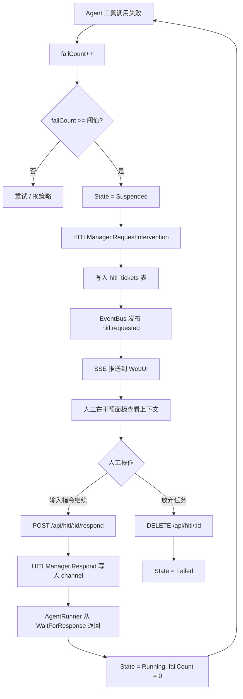

# Gateway & API 设计

> 状态：Legacy reference
> 说明：本文档基于旧 `v1 foundation` 假设撰写，当前仅作为历史参考。新的 `v0` 主线请先看 `docs/README.md`。

> 所属层级：接入层 | 相关文档：[架构总纲](./00-overview.md) | [Orchestrator 事件总线](./02-orchestrator.md#3-事件hook-总线)

---

## 1. 职责边界

Gateway 层负责：

- **HTTP REST API**：任务提交、查询、控制
- **SSE 实时推送**：将 EventBus 事件流推送至前端
- **上帝模式**：运行时向 Agent 注入高优先级指令
- **HITL 干预面板**：人工查看挂起 ticket、输入指令
- **WebUI 服务**：嵌入式单页应用，go:embed 打包

---

## 2. REST API

### 2.1 API 端点总览

| 方法 | 路径 | 说明 |
|------|------|------|
| POST | `/api/tasks` | 提交新任务 |
| GET | `/api/tasks` | 列举任务（支持过滤） |
| GET | `/api/tasks/{id}` | 获取任务详情 |
| DELETE | `/api/tasks/{id}` | 取消任务 |
| GET | `/api/tasks/{id}/trace` | 获取任务追踪树 |
| GET | `/api/agents` | 列举 Agent |
| GET | `/api/agents/{id}` | 获取 Agent 详情 |
| POST | `/api/agents/{id}/inject` | 上帝模式：注入指令 |
| GET | `/api/hitl` | 列举待处理 HITL tickets |
| POST | `/api/hitl/{ticket_id}/respond` | 响应 HITL 干预 |
| DELETE | `/api/hitl/{ticket_id}` | 关闭 HITL ticket |
| GET | `/api/events` | SSE 事件流（见下节） |
| GET | `/api/health` | 健康检查 |

### 2.2 任务提交

```
POST /api/tasks
Content-Type: application/json

{
  "title": "重构认证模块",
  "description": "将 JWT 认证逻辑抽取为独立中间件...",
  "mode": "auto",          // "auto" | "single" | "team"
  "soul_files": ["architect", "coder"],  // 可选，指定 Agent 角色
  "metadata": {}
}

Response 200:
{
  "task_id": "t-abc123",
  "trace_id": "tr-xyz789",
  "status": "pending"
}
```

### 2.3 上帝模式注入

```
POST /api/agents/{agent_id}/inject
Content-Type: application/json

{
  "instruction": "请改变策略，优先处理性能问题",
  "priority": "high"   // "high" 插入 Memory 最高优先级
}
```

注入后，指令作为高优先级 system 消息插入 Agent Memory，下一步 LLM 推理时生效。

**安全边界（重要）**：

注入指令 **不可以** 覆盖或绕过 `SOUL.md` / `AGENTS.md` 中定义的角色约束：

| 注入可以做 | 注入不可以做 |
|-----------|-------------|
| 调整当前任务的执行策略 | 修改 Agent 的工具白名单 |
| 提供额外上下文或补充信息 | 覆盖 SOUL.md 的 constraints 字段 |
| 要求重新思考或换个方向 | 突破 SOUL.md 定义的角色边界 |
| 紧急中止当前步骤 | 绕过 AGENTS.md 的全局行为规范 |

权限层在每次 LLM 推理前校验注入指令，拒绝包含越权意图的内容（见 [Orchestrator 权限层](./02-orchestrator.md#4-权限与生命周期层)）。

---

## 3. SSE 实时推送

### 3.1 连接方式

```
GET /api/events?trace_id=tr-xyz789
Accept: text/event-stream
```

客户端通过 `trace_id` 参数订阅特定任务的事件流；省略 `trace_id` 则订阅全局事件。

### 3.2 SSE Handler 实现

```go
// EventBus：内部事件总线（详见 02-orchestrator.md）
func (h *Handler) StreamEvents(w http.ResponseWriter, r *http.Request) {
    w.Header().Set("Content-Type", "text/event-stream")
    w.Header().Set("Cache-Control", "no-cache")
    w.Header().Set("Connection", "keep-alive")

    traceID := r.URL.Query().Get("trace_id")
    topic := "trace." + traceID
    if traceID == "" {
        topic = "*"
    }

    ch := h.bus.Subscribe(topic)
    defer h.bus.Unsubscribe(topic, ch)

    for {
        select {
        case event := <-ch:
            fmt.Fprintf(w, "event: %s\n", event.Topic)
            fmt.Fprintf(w, "data: %s\n\n", event.JSON())
            w.(http.Flusher).Flush()
        case <-r.Context().Done():
            return
        }
    }
}
```

### 3.3 SSE 事件格式

```
event: agent.state.changed
data: {"agent_id":"a-123","trace_id":"tr-xyz","state":"running","timestamp":"..."}

event: tool.call.completed
data: {"agent_id":"a-123","tool":"file_write","status":"ok","duration_ms":45}

event: hitl.requested
data: {"ticket_id":"h-456","agent_id":"a-123","reason":"连续失败3次","context":"..."}

event: task.completed
data: {"task_id":"t-abc","trace_id":"tr-xyz","success":true,"summary":"..."}
```

---

## 4. HITL 干预流程



### HITL 触发条件（可配置）

| 条件 | 默认值 |
|------|--------|
| 连续工具失败 N 次 | 3 次 |
| 高风险工具执行前确认 | 每次（`require_approval: true`） |
| 任务目标不明确 | LLM 主动发起 |
| Cron 决策置信度低 | 感知数据不足时 |

---

## 5. WebUI 功能

WebUI 使用 **Vue** 构建，通过 go:embed 打包为单二进制，访问 `http://localhost:8080`：

| 页面 | 功能 |
|------|------|
| 任务列表 | 任务状态、创建时间、实时更新（SSE） |
| 任务详情 | Trace 调用树可视化、Agent 日志流 |
| HITL 干预面板 | 挂起 ticket 列表、上下文查看、指令输入框 |
| Agent 监控 | 活跃 Agent 列表、状态、token 用量 |
| 上帝模式 | 选择 Agent、输入注入指令 |
| Cron 管理 | 定时任务列表、创建/编辑/启停（与 CLI 同步） |

---

## 6. 多渠道接入（可选）

Gateway 设计支持未来扩展多渠道接入，不限于 Web：

| 渠道 | 接入方式 |
|------|----------|
| Web UI | 内嵌 SPA，go:embed |
| TUI | 命令行交互界面（cmd/axon） |
| IM Webhook | 接收消息体，包装成 TaskRequest 提交 |
| API Client | pkg/client SDK |

所有渠道共用同一套 Orchestrator 和事件总线，Gateway 只做协议转换。
