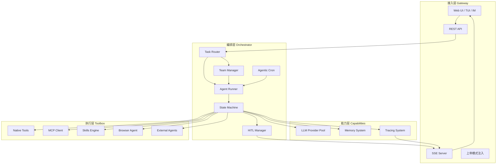
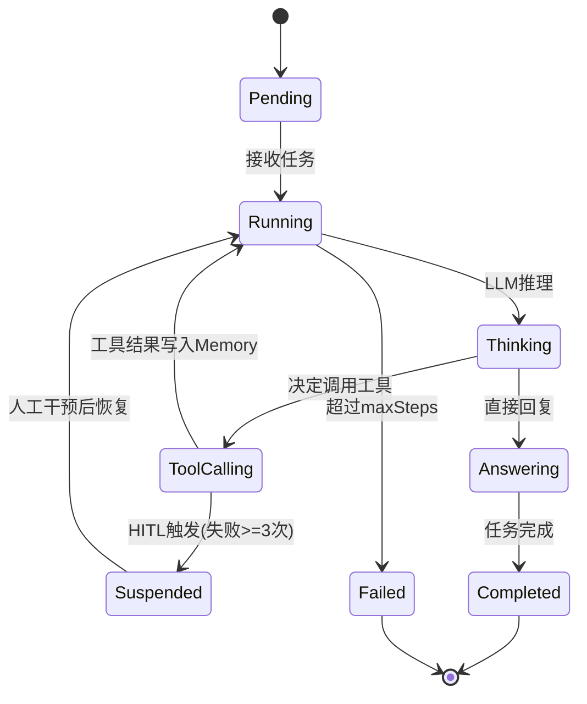
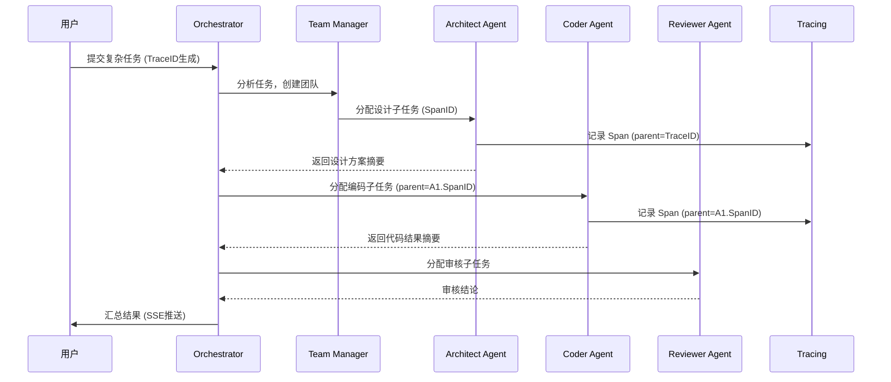
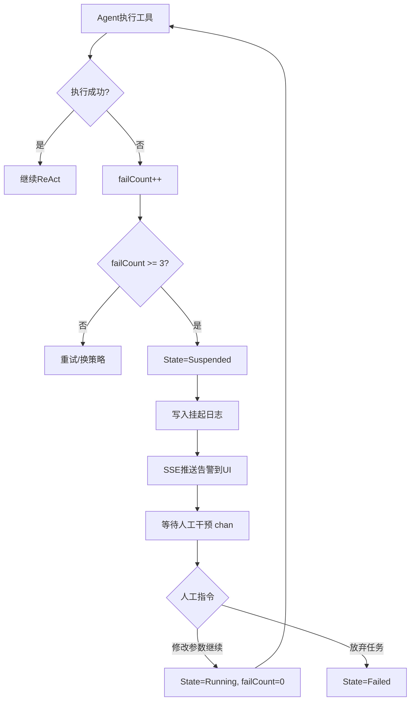
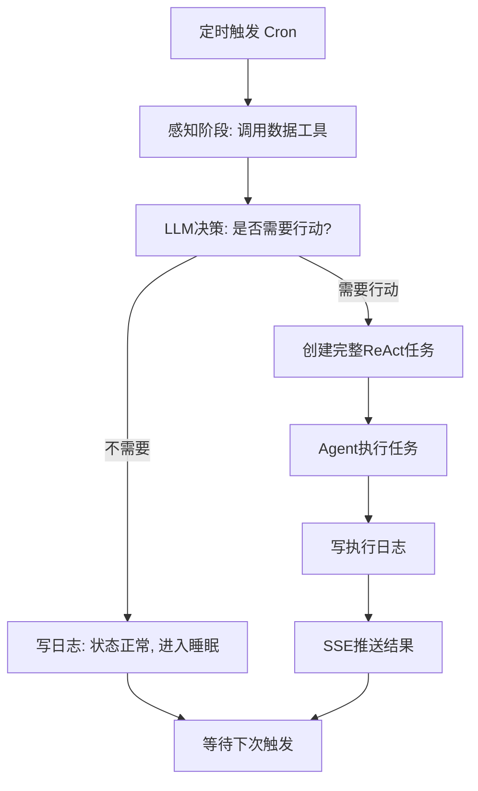

# kagent 系统架构设计

> 文档状态：草稿 v0.1 | 日期：2026-03-15

---

## 目录

1. [项目概述与设计目标](#1-项目概述与设计目标)
2. [需求关联分析](#2-需求关联分析)
3. [整体架构设计](#3-整体架构设计)
4. [核心数据模型](#4-核心数据模型)
5. [关键流程设计](#5-关键流程设计)
6. [各模块详细设计](#6-各模块详细设计)
7. [Go 项目目录结构](#7-go-项目目录结构)
8. [技术选型](#8-技术选型)
9. [分阶段实施规划](#9-分阶段实施规划)
10. [待确认问题清单](#10-待确认问题清单)
11. [风险与注意事项](#11-风险与注意事项)

---

## 1. 项目概述与设计目标

### 1.1 定位

kagent 是一个以 **Go 语言**构建的本地优先 AI Agent 编排引擎，定位为：

- **大脑入口**：统一接收用户任务，分解并分发给专家 Agent 团队
- **长期记忆**：通过 SQLite + 向量搜索实现跨会话记忆
- **团队编排**：动态组建专家团队，每个 Agent 有独立的角色定义（SOUL.md）
- **工具生态**：接入 Native Tools、MCP Server、Skills 脚本、Browser Agent
- **外部协作**：可调用 claude-code、opencode 等外部 AI 工具完成专项任务
- **最小人工干预**：只在关键决策节点触发 HITL（人机协作）

### 1.2 核心设计原则

| 原则 | 说明 |
|------|------|
| 单一可执行文件 | 嵌入 SQLite，无外部依赖，开箱即用 |
| 接口驱动 | LLM、Memory、VectorStore 均面向接口，易于替换 |
| 上下文隔离 | Subagent 在独立会话运行，只向 Parent 返回结构化结果 |
| 全链路可观测 | 每个操作绑定 TraceID/SpanID，实时 SSE 推送 |
| 失败恢复 | 内置重试 + HITL 挂起机制，Agent 连续失败不崩溃 |

---

## 2. 需求关联分析

### 2.1 功能依赖图

```
用户输入
    │
    ▼
[Gateway/UI] ──SSE──► [Web仪表盘]
    │
    ▼
[Orchestrator / Task Router]
    │
    ├──► [Agent Runner] ──► [ReAct Loop]
    │         │                   │
    │         │              ┌────┴────────────────┐
    │         │              ▼                     ▼
    │         │        [LLM Provider]        [Tool Registry]
    │         │              │               ├─ Native Tools
    │         │              │               ├─ MCP Server
    │         │              │               ├─ Skills (SKILL.md)
    │         │              │               └─ Browser Agent
    │         │
    │         ├──► [Memory System]
    │         │         ├─ Short-term (in-process)
    │         │         └─ Long-term (SQLite + sqlite-vec)
    │         │
    │         ├──► [Tracing System] ──► [TraceID/SpanID]
    │         │
    │         └──► [HITL Manager] ──SSE──► [人工干预通道]
    │
    ├──► [Team Manager]
    │         ├─ SOUL.md 解析
    │         ├─ 专家 Agent 创建
    │         └─ 任务分配
    │
    └──► [Agentic Cron]
              ├─ 定时触发
              ├─ 感知 → 决策
              └─ 条件执行
```

### 2.2 数据流

```
用户请求 → TraceID生成 → Orchestrator分析
    → 是否需要团队？
        [是] → Team Manager创建专家组 → 各Agent领取子任务
        [否] → 单Agent直接执行
    → Agent ReAct Loop
        → Memory检索历史上下文
        → LLM推理（含Tool Schema）
        → 工具调用 → 结果写入Memory + Trace
        → 判断完成/继续/挂起(HITL)
    → 汇总结果 → SSE推送 → 存储长期记忆
```

### 2.3 关键约束与边界

- **上下文膨胀**：Subagent 独立 Memory，只向 Parent 返回摘要
- **并发安全**：多 Agent 并发访问 SQLite 需读写锁策略
- **外部 Agent 隔离**：claude-code 等外部工具通过 subprocess + workspace 目录隔离

---

## 3. 整体架构设计

### 3.1 分层架构总图



### 3.2 分层职责

| 层级 | 组件 | 职责 |
|------|------|------|
| 接入层 | Gateway | 协议适配（HTTP/SSE/WebSocket）、认证、"上帝模式"指令注入 |
| 编排层 | Orchestrator | 任务路由、团队管理、Agent 生命周期、HITL 挂起/恢复 |
| 能力层 | Capabilities | LLM 调用池、记忆管理、全链路追踪 |
| 执行层 | Toolbox | 工具执行沙箱、MCP 协议客户端、Skills 脚本调度、浏览器自动化 |

---

## 4. 核心数据模型

```go
// ===== Agent 相关 =====

type AgentState string
const (
    AgentPending    AgentState = "pending"
    AgentRunning    AgentState = "running"
    AgentSuspended  AgentState = "suspended"  // HITL 挂起
    AgentCompleted  AgentState = "completed"
    AgentFailed     AgentState = "failed"
)

type Agent struct {
    ID          string
    Name        string
    Soul        *Soul         // SOUL.md 解析结果
    State       AgentState
    Memory      MemoryStore
    Tools       []Tool
    LLM         LLMProvider
    ParentID    string        // 上级 Agent ID（subagent 用）
    TraceID     string
    SpanID      string
    FailCount   int
    CreatedAt   time.Time
}

// SOUL.md 解析结果
type Soul struct {
    Name        string
    Role        string        // 角色描述
    Expertise   []string      // 专长领域
    Skills      []string      // 可用 skills
    Tools       []string      // 可用工具白名单
    Constraints []string      // 行为约束
    Persona     string        // 完整 system prompt
}

// ===== Team 相关 =====

type Team struct {
    ID          string
    Name        string
    Goal        string
    Agents      map[string]*Agent
    Tasks       []*Task
    TraceID     string
    State       TeamState
    CreatedAt   time.Time
}

// ===== Task 相关 =====

type TaskStatus string
const (
    TaskPending    TaskStatus = "pending"
    TaskRunning    TaskStatus = "running"
    TaskBlocked    TaskStatus = "blocked"   // HITL 等待
    TaskDone       TaskStatus = "done"
    TaskFailed     TaskStatus = "failed"
)

type Task struct {
    ID          string
    Title       string
    Description string
    AssignedTo  string        // Agent ID
    Status      TaskStatus
    Result      string
    ParentID    string        // 父任务 ID
    TraceID     string
    SpanID      string
    CreatedAt   time.Time
    UpdatedAt   time.Time
}

// ===== Memory 相关 =====

type Message struct {
    Role      string    // user / assistant / tool / system
    Content   string
    ToolCall  *ToolCall
    Timestamp time.Time
}

type MemoryFragment struct {
    ID        string
    Content   string
    Embedding []float32
    Source    string    // agent_id / task_id
    CreatedAt time.Time
}

// ===== Trace 相关 =====

type Span struct {
    TraceID    string
    SpanID     string
    ParentID   string
    AgentID    string
    Operation  string    // "llm_call" / "tool_call" / "hitl_wait" 等
    Input      string
    Output     string
    StartTime  time.Time
    EndTime    time.Time
    Status     string
    Error      string
}

// ===== Tool 相关 =====

type ToolKind string
const (
    ToolNative  ToolKind = "native"
    ToolMCP     ToolKind = "mcp"
    ToolSkill   ToolKind = "skill"
    ToolBrowser ToolKind = "browser"
    ToolExtAgent ToolKind = "ext_agent"
)

type Tool interface {
    Name() string
    Description() string
    Schema() ToolSchema
    Execute(ctx context.Context, args map[string]any) (string, error)
}

type ToolCall struct {
    Name      string
    Arguments map[string]any
}
```

---

## 5. 关键流程设计

### 5.1 单 Agent ReAct Loop 状态机



### 5.2 多 Agent 团队协作流程



### 5.3 HITL 干预流程



### 5.4 Agentic Cron 流程



---

## 6. 各模块详细设计

### 6.1 Core Agent 引擎

**职责**：驱动单个 Agent 的 ReAct（Reason + Act）循环。

**核心接口**：
```go
type AgentRunner interface {
    Run(ctx context.Context, task *Task) (*TaskResult, error)
    Suspend(reason string) error
    Resume(instruction string) error
    GetState() AgentState
}

type ReactLoop struct {
    agent    *Agent
    maxSteps int
    tracer   Tracer
    hitl     HITLManager
}
```

**执行逻辑**：
1. 从 Memory 检索相关历史 → 构建 context
2. 调用 LLM（含工具 Schema）→ 获取响应
3. 若有 ToolCall → 执行工具 → 结果写 Memory
4. 若无 ToolCall → 判断是否完成
5. 工具执行失败计数 → 达阈值触发 HITL
6. 每步记录 Span

### 6.2 Team Manager

**职责**：创建专家团队，解析 SOUL.md，分配子任务。

**核心接口**：
```go
type TeamManager interface {
    CreateTeam(goal string, soulFiles []string) (*Team, error)
    AssignTask(team *Team, task *Task) error
    MonitorTeam(ctx context.Context, team *Team) <-chan TeamEvent
    DisbandTeam(teamID string) error
}
```

**SOUL.md 格式**（建议）：
```yaml
name: "Architect"
role: "系统架构设计专家"
expertise:
  - "系统设计"
  - "Go语言架构"
tools:
  - "web_search"
  - "file_read"
constraints:
  - "只输出设计文档，不写代码"
persona: |
  你是一名资深系统架构师...
```

**任务分配策略**：
- 简单任务：直接分配给匹配专长的 Agent
- 复杂任务：Orchestrator LLM 分析后拆分子任务 DAG，按依赖顺序分配

### 6.3 Memory System

**职责**：短期上下文管理 + 长期语义记忆存储与检索。

**核心接口**：
```go
type MemoryStore interface {
    AddMessage(role, content string)
    GetContext(maxTokens int) []Message    // 近期消息
    SearchSimilar(query string, topK int) ([]MemoryFragment, error)
    SaveFragment(content string, source string) error
    Summarize(messages []Message) string   // 长对话压缩
}

type VectorStore interface {
    Insert(id string, embedding []float32, metadata map[string]any) error
    Search(query []float32, topK int) ([]SearchResult, error)
}
```

**实现层次**：
```
MemoryStore
├── InMemory（短期：当前会话消息列表）
│   └── 超过 N 条时自动调 LLM 压缩摘要
└── SQLiteMemory（长期持久化）
    ├── messages 表（对话历史）
    ├── fragments 表（记忆片段）
    └── embeddings（sqlite-vec 向量索引）
```

**检索流程**：
1. 用户提问 → 调 Embedding API 生成向量
2. sqlite-vec ANN 搜索 topK 相关记忆
3. 拼接相关记忆 + 近期消息 → 发给 LLM
4. LLM 回复后 → 存储新记忆片段

### 6.4 Tracing System

**职责**：全链路追踪，记录 Agent 操作因果关系。

**核心接口**：
```go
type Tracer interface {
    StartSpan(ctx context.Context, op string) (context.Context, *Span)
    FinishSpan(span *Span, err error)
    GetTrace(traceID string) ([]*Span, error)
}

// context 中携带 trace 信息
type TraceContext struct {
    TraceID  string
    SpanID   string
    ParentID string
}
```

**存储**：SQLite `spans` 表，实时写入。

**SSE 推送**：Span 完成时通过 EventBus 推送到 Gateway，前端实时展示调用树。

### 6.5 Tool Registry

**职责**：统一管理三类工具，提供工具发现与执行。

**三类工具**：

| 类型 | 注册方式 | 执行方式 |
|------|----------|----------|
| Native | 代码注册 | 直接函数调用 |
| MCP | 配置文件 | JSON-RPC over stdio/SSE |
| Skill | SKILL.md 解析 | Shell/Python subprocess |
| Browser | 内置 | chromedp 控制 |
| ExtAgent | 配置 | subprocess + 结果解析 |

**Skills 引擎**（SKILL.md 解析）：
```go
type Skill struct {
    Name        string
    Description string
    InputSchema ToolSchema
    Command     string    // shell 命令模板
    Type        string    // "shell" | "python"
}

// SKILL.md 示例格式
// ---
// name: run_tests
// description: 运行单元测试
// type: shell
// command: "cd {{workspace}} && go test ./..."
// ---
```

**外部 Agent 调用**：
```go
type ExtAgentTool struct {
    name      string    // "claude-code" | "opencode"
    binary    string    // 可执行文件路径
    workspace string    // 隔离工作目录
}

func (t *ExtAgentTool) Execute(ctx context.Context, args map[string]any) (string, error) {
    // 1. 准备 workspace
    // 2. 写入任务描述文件
    // 3. subprocess 调用外部 agent
    // 4. 读取输出结果
    // 5. 清理临时文件
}
```

### 6.6 LLM Provider Pool

**职责**：统一多家 LLM 供应商接口，支持故障转移和负载均衡。

**核心接口**：
```go
type LLMProvider interface {
    Complete(ctx context.Context, req *CompletionRequest) (*CompletionResponse, error)
    Stream(ctx context.Context, req *CompletionRequest) (<-chan string, error)
    Embed(ctx context.Context, text string) ([]float32, error)
}

type CompletionRequest struct {
    Messages    []Message
    Tools       []ToolSchema
    MaxTokens   int
    Temperature float32
    Model       string
}

type CompletionResponse struct {
    Content    string
    ToolCalls  []ToolCall
    Usage      TokenUsage
    FinishReason string
}
```

**Provider Pool**：
- 主备切换：主 provider 失败自动切换备用
- 按模型路由：embedding 任务用轻量模型，推理任务用强模型
- 重试策略：指数退避，最多 3 次

### 6.7 Agentic Cron

**职责**：智能定时任务，具备感知-决策-执行能力。

```go
type CronJob struct {
    ID          string
    Name        string
    Schedule    string        // cron 表达式
    SenseTools  []string      // 感知阶段使用的工具
    DecisionPrompt string     // 决策 prompt 模板
    AgentConfig *AgentConfig  // 执行阶段 Agent 配置
    LastRunAt   time.Time
    LastResult  string
}
```

**执行流程**：
1. 定时触发 → 创建临时 Agent
2. Agent 调用 SenseTools 获取当前状态
3. LLM 决策："根据当前信息，是否需要行动？输出 JSON: {action: bool, reason: string}"
4. action=true → 启动完整 ReAct 任务
5. action=false → 写日志 + 进入下次等待

### 6.8 HITL Manager

**职责**：管理人机协作干预点，挂起/恢复 Agent 执行。

```go
type HITLManager interface {
    RequestIntervention(ctx context.Context, agentID string, reason string) (*HITLTicket, error)
    // 阻塞等待人工响应（通过 channel）
    WaitForResponse(ctx context.Context, ticketID string) (*HITLResponse, error)
    Respond(ticketID string, instruction string) error
    Dismiss(ticketID string, reason string) error
}

type HITLTicket struct {
    ID         string
    AgentID    string
    Reason     string
    Context    string    // 失败的工具调用上下文
    CreatedAt  time.Time
    Status     string    // "waiting" | "responded" | "dismissed"
}
```

**触发条件**（可配置）：
- Agent 连续失败 N 次（默认 3）
- 特定工具执行前需确认（高风险操作）
- 任务目标不明确，需人工澄清
- Agentic Cron 决策置信度低

### 6.9 Gateway & WebUI

**职责**：HTTP 服务、SSE 实时推送、Web 仪表盘。

**SSE 推送方案**：
```go
// EventBus：内部事件总线
type EventBus interface {
    Publish(event Event)
    Subscribe(agentID string) <-chan Event
    Unsubscribe(agentID string)
}

// SSE Handler
func (h *Handler) StreamEvents(w http.ResponseWriter, r *http.Request) {
    w.Header().Set("Content-Type", "text/event-stream")
    w.Header().Set("Cache-Control", "no-cache")

    ch := h.bus.Subscribe(r.URL.Query().Get("trace_id"))
    defer h.bus.Unsubscribe(...)

    for event := range ch {
        fmt.Fprintf(w, "data: %s\n\n", event.JSON())
        w.(http.Flusher).Flush()
    }
}
```

**"上帝模式"注入**：
- REST API：`POST /api/agent/{id}/inject`
- Body：`{"instruction": "...", "priority": "high"}`
- 注入后插入 Agent Memory 最高优先级消息

**Web UI 功能**：
- 任务列表 + 实时状态（SSE）
- Trace 调用树可视化
- HITL 干预面板（查看挂起 ticket，输入指令）
- Agent 日志流

---

## 7. Go 项目目录结构

```
kagent/
├── cmd/
│   ├── kagent/          # 主程序入口
│   │   └── main.go
│   └── server/          # HTTP Server 模式
│       └── main.go
│
├── internal/
│   ├── agent/           # Agent 核心
│   │   ├── agent.go     # Agent 结构体与接口
│   │   ├── runner.go    # ReAct Loop 实现
│   │   ├── state.go     # 状态机
│   │   └── soul.go      # SOUL.md 解析
│   │
│   ├── team/            # 团队管理
│   │   ├── manager.go
│   │   └── task.go
│   │
│   ├── memory/          # 记忆系统
│   │   ├── store.go     # MemoryStore 接口
│   │   ├── inmem.go     # 内存实现
│   │   ├── sqlite.go    # SQLite 持久化
│   │   └── vector.go    # sqlite-vec 封装
│   │
│   ├── llm/             # LLM Provider
│   │   ├── provider.go  # Provider 接口
│   │   ├── openai.go    # OpenAI 实现
│   │   ├── claude.go    # Claude 实现
│   │   ├── deepseek.go  # DeepSeek 实现
│   │   └── pool.go      # Provider Pool
│   │
│   ├── tools/           # 工具系统
│   │   ├── registry.go  # 工具注册中心
│   │   ├── native/      # 原生工具
│   │   │   ├── file.go
│   │   │   ├── search.go
│   │   │   └── code_exec.go
│   │   ├── mcp/         # MCP 客户端
│   │   │   ├── client.go
│   │   │   └── protocol.go
│   │   ├── skills/      # Skills 引擎
│   │   │   ├── parser.go
│   │   │   └── runner.go
│   │   ├── browser/     # Browser Agent
│   │   │   └── agent.go
│   │   └── external/    # 外部 Agent 调用
│   │       └── agent.go
│   │
│   ├── tracing/         # 链路追踪
│   │   ├── tracer.go
│   │   ├── span.go
│   │   └── store.go
│   │
│   ├── hitl/            # HITL 管理
│   │   ├── manager.go
│   │   └── ticket.go
│   │
│   ├── cron/            # Agentic Cron
│   │   ├── scheduler.go
│   │   └── job.go
│   │
│   ├── gateway/         # 接入层
│   │   ├── server.go
│   │   ├── sse.go
│   │   ├── handler.go
│   │   └── eventbus.go
│   │
│   └── orchestrator/    # 编排层
│       ├── orchestrator.go
│       └── router.go
│
├── pkg/                 # 可对外暴露的包
│   └── client/          # SDK/客户端
│
├── web/                 # 前端资源（嵌入）
│   └── dist/
│
├── configs/             # 配置文件模板
│   ├── config.yaml
│   └── souls/           # 默认 SOUL.md 模板
│
├── skills/              # 内置 SKILL.md 文件
│
├── go.mod
├── go.sum
└── Makefile
```

---

## 8. 技术选型

| 类别 | 选型 | 说明 |
|------|------|------|
| 语言 | Go 1.22+ | 原生并发，单二进制分发 |
| 数据库 | SQLite (modernc/sqlite) | 零依赖，嵌入式 |
| 向量搜索 | sqlite-vec | SQLite 扩展，ANN 搜索 |
| HTTP 框架 | net/http + chi router | 轻量，标准库兼容 |
| 配置 | viper | 支持 YAML/环境变量 |
| 日志 | slog (标准库) | 结构化日志 |
| 向量 Embedding | 可配置：OpenAI / Ollama nomic-embed | 接口抽象 |
| MCP 协议 | 自实现 JSON-RPC over stdio | 参考官方 spec |
| 浏览器自动化 | chromedp | Go 原生 |
| 前端 | 嵌入式 SPA（Vue/React） | go:embed 打包 |
| 测试 | testing + testify | 标准 |
| 构建 | Makefile + goreleaser | 跨平台构建 |

### 8.1 关键依赖说明

**SQLite 选型**：推荐 `modernc.org/sqlite`（纯 Go，无 cgo），便于跨平台编译。
**sqlite-vec**：需要 cgo 或预编译 .so，需在 Phase 1 评估可行性。
**MCP 协议**：参考 https://spec.modelcontextprotocol.io/，核心是 JSON-RPC 2.0 over stdio 或 SSE。

---

## 9. 分阶段实施规划

### Phase 1：单 Agent MVP（2-3周）

**目标**：可运行的单 Agent CLI，核心 ReAct Loop 验证。

**交付物**：
- [ ] 基础 ReAct Loop（最大步数限制）
- [ ] LLM Provider（OpenAI/Claude 任选一）
- [ ] InMemory 记忆（消息列表 + 摘要）
- [ ] 3 个 Native 工具：file_read、file_write、shell_exec
- [ ] 基础 Tracing（内存存储）
- [ ] CLI 交互界面（TUI）

**技术验证点**：sqlite-vec 可用性（若有问题，Phase 2 再引入）

---

### Phase 2：持久化 + 工具扩展（2-3周）

**目标**：记忆持久化，工具生态初步搭建。

**交付物**：
- [ ] SQLite 持久化记忆（messages + fragments）
- [ ] sqlite-vec 向量搜索（或 fallback 到 BM25 关键词搜索）
- [ ] LLM Embedding 接入
- [ ] MCP 协议客户端（stdio 模式）
- [ ] web_search 工具（SerpAPI）
- [ ] Docker 沙箱代码执行
- [ ] SOUL.md 解析与 Agent 角色配置

---

### Phase 3：多 Agent 团队协作（3-4周）

**目标**：团队编排，Subagent 隔离，完整追踪。

**交付物**：
- [ ] Team Manager（团队创建、任务分配）
- [ ] Subagent 隔离（独立 Memory + 独立 LLM 会话）
- [ ] SQLite Tracing（TraceID/SpanID 持久化）
- [ ] HITL Manager（channel 挂起/恢复）
- [ ] 基础 SSE Server（追踪事件推送）
- [ ] Skills Engine（SKILL.md 解析 + shell 执行）

---

### Phase 4：Gateway + WebUI（3-4周）

**目标**：Web 仪表盘，实时监控，"上帝模式"。

**交付物**：
- [ ] HTTP REST API（任务提交、查询）
- [ ] SSE 事件流（实时追踪展示）
- [ ] Web UI：任务列表、Trace 可视化、日志流
- [ ] HITL 干预面板（Web 端）
- [ ] "上帝模式"指令注入 API
- [ ] 多渠道接入（可选：IM webhook）

---

### Phase 5：外部 Agent + 智能 Cron（2-3周）

**目标**：接入 claude-code/opencode，部署智能定时任务。

**交付物**：
- [ ] 外部 Agent 调用框架（subprocess + workspace 隔离）
- [ ] claude-code 工具适配
- [ ] opencode 工具适配
- [ ] Agentic Cron 调度器
- [ ] Browser Agent（chromedp 基础功能）
- [ ] 多 LLM Provider Pool（故障转移）

---

### Phase 6：生产增强（持续迭代）

**目标**：稳定性、可观测性、扩展性增强。

**交付物**：
- [ ] PGVector 可选支持（VectorStore 接口替换）
- [ ] Agent 性能监控（token 用量、耗时统计）
- [ ] 配置热重载
- [ ] 权限系统（工具白名单、工作目录沙箱）
- [ ] Agent 市场/模板库
- [ ] 完整文档 + 示例

---

## 10. 待确认问题清单

### P0 - 阻断性问题（必须在开发前确认）

| # | 问题 | 影响 |
|---|------|------|
| P0-1 | **SOUL.md 格式**：是 YAML front matter + Markdown 正文，还是纯 YAML，还是自定义格式？ | 影响 Team Manager 和 Agent 角色解析核心实现 |
| P0-2 | **外部 Agent 协议**：claude-code / opencode 通过 stdin/stdout 传递任务，还是通过文件，还是 API？具体的输入输出格式？ | 影响 ExtAgent 工具实现方案 |
| P0-3 | **Embedding 模型**：使用云端 API（OpenAI/Claude）还是本地 Ollama？考虑到长期记忆检索的延迟和成本 | 影响 Memory System 设计 |

### P1 - 重要问题（Phase 2 前确认）

| # | 问题 | 影响 |
|---|------|------|
| P1-1 | **SKILL.md 格式**：flow 类型 skill 的具体语法？如何描述"调用 subagent"的步骤？ | 影响 Skills Engine 复杂度 |
| P1-2 | **"上帝模式"安全边界**：注入指令有无权限限制？是否可以覆盖 Agent 的 SOUL.md 约束？ | 影响安全模型设计 |
| P1-3 | **Team 任务分配策略**：是由 Orchestrator LLM 自动分解任务 DAG，还是用户手工定义团队工作流？ | 影响 Team Manager 智能化程度 |
| P1-4 | **Subagent 结果格式**：Subagent 向 Parent 返回的是纯文本摘要，还是结构化 JSON？ | 影响上下文拼接逻辑 |

### P2 - 可后续讨论

| # | 问题 |
|---|------|
| P2-1 | Web UI 技术栈偏好（Vue/React/纯 HTML）？ |
| P2-2 | 多用户支持是否在计划内？（涉及隔离和权限） |
| P2-3 | Agentic Cron 的任务定义是配置文件还是 Web UI 管理？ |
| P2-4 | 是否需要 Agent 执行历史的导出功能（JSON/CSV）？ |
| P2-5 | 项目是否计划开源？（影响部分第三方库选型） |

---

## 11. 风险与注意事项

### 11.1 技术风险

| 风险 | 等级 | 缓解策略 |
|------|------|----------|
| sqlite-vec 跨平台兼容性 | 高 | Phase 1 先用纯 BM25 关键词搜索兜底，向量搜索作可选项 |
| LLM 上下文长度限制 | 中 | 强制摘要压缩 + subagent 隔离，控制单次请求 token |
| 外部 Agent subprocess 超时 | 中 | 强制 timeout + goroutine 取消，避免僵尸进程 |
| SQLite 并发写性能 | 中 | WAL 模式 + 写操作串行化（单 writer goroutine） |
| Agent 无限循环 | 低 | maxSteps 硬限制 + token 预算限制 |

### 11.2 设计注意事项

1. **工作目录沙箱**：文件操作工具必须限定在 workspace 目录内，防止越权访问
2. **Token 预算追踪**：每个 Agent 应有 token 上限配置，防止单任务超额消费
3. **日志与记忆分离**：结构化日志（用于调试）和 Agent 记忆（用于 LLM context）是两个独立系统
4. **接口稳定性**：LLM Provider / MemoryStore / VectorStore 接口一旦确定，尽量不要破坏性变更
5. **错误传播**：工具执行错误应该作为 tool_result 消息返回给 LLM，而不是直接 panic
