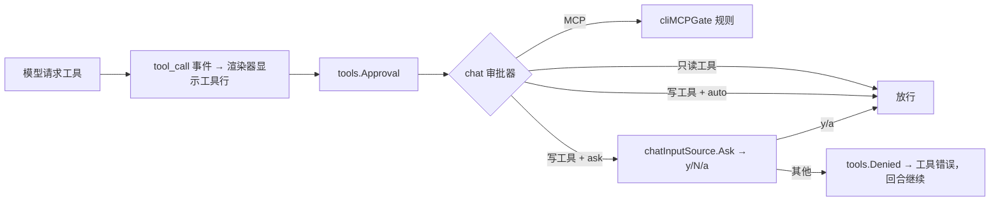

<!-- template_id: design; template_version: 1.1.1 -->
# Suag chat 写工具开关、交互确认与遗留小项 设计

> 状态：Draft 0.2 / 待人工计划批准

## 修订记录

| 版本 | 日期 | 作者 | 摘要 |
|---|---|---|---|
| 0.1 | 2026-10-09 | Claude | 初稿 |
| 0.2 | 2026-10-09 | Claude | 按合并评审修订：交互确认的读取状态机（原 CORE_BLOCKING：raw/cooked 切换、activity 握手、挂起读与预输入、Ctrl-C 实际语义）；审批器后绑定注入方式；确认时显示完整命令/路径；写工具改为“只读名单之外一律询问”（含 web_search）；拒绝计数与提示；allow_write 作用范围（Q3）；越界判断改为结构化；小项实现细节 |

> 仅语义变化递增版本；纯 identity/provenance/元数据纠正沿用原版本，并在 Git/进度记录中留痕。

## 背景与目标

思考模式 RIGOROUS；核心目标：让 chat 能安全地使用写文件与 shell 工具，并清理 `suag-iw3u` 中可在代码内完成的遗留项。scope freeze：下列三部分；review budget：一轮合并轴评审（低暴露度，SR1409）；停止条件：评审无 CORE_BLOCKING 且用户批准。

用户可见结果：

1. 配置 `tools.allow_write: true` 后，`suag run`/`suag chat` 不必每次加 `--allow-write` 就能使用 `file_write`、`shell_exec`（及配置了 `serpapi_key` 时的 `web_search`）。
2. chat 中模型调用需确认的工具前，终端先显示完整调用内容并询问 `[y/N/a]`；拒绝时模型收到工具错误、回合继续。
3. 遗留小项：trace 显示计划；stream-json 输出工具调用与结果行；路径越界判断不再依赖错误文案；ACP 写入预览不会被特殊文件阻塞；ACP 回合提前失败时用量不再报 0；agentcore 工作记忆视图保留工具调用前的助手文字。

## 名词

- **需确认的工具**：只读名单（`file_read`、`file_list`、`update_plan`、`tool_search`）之外的所有非 MCP 工具，目前即 `file_write`、`shell_exec`、`web_search`（`web_search` 会把查询发到外部，按外发处理）；以后新增的内置工具默认也需确认。
- **交互确认**：chat 在执行写工具前，在终端向用户询问是否允许。

## 范围与非目标

范围：suag 仓库 `internal/{config,wiring,chat,cli,acpserver,platform/tools/native,personal}`、`pkg/agentcore/memory`、文档与样例。

非目标：

- 不改 MCP 工具的放行规则（`tools.auto_allow`/`read_only_allow` 不变；未放行的 MCP 工具仍直接拒绝，不在 chat 中询问）。
- 不改 ACP 的审批（ACP 已由客户端逐次审批）。
- 不新增局部编辑工具（`file_edit`）；不处理 Claude 思考内容回传（suag 未开启 Claude 思考模式）；Windows 人工确认项不在代码范围。

## 已确认事实与规范

- CLI 默认工具：`file_read`、`file_list`、`update_plan` 与配置的 MCP；`--allow-write` 时改为全部内置工具（`internal/wiring/runtime.go` `buildPersonalCLICapabilities` → `buildDefaultCapabilitiesWithServers`，含 `shell_exec` 与有 `serpapi_key` 时的 `web_search`）。
- 审批层：`tools.Approval` 在执行前调用 `Approver.Decide`；返回 `tools.Denied` 时模型收到工具错误、回合继续（同一回合累计 3 次拒绝结束回合）；其他错误中止回合（`internal/platform/tools/approval.go`）。CLI 现用 `cliMCPGate`，内置工具一律放行。
- chat 输入由 `chatInputSource` 管理：回合进行中读取器可能仍有一个挂起的读请求；socket 投递经 `deliveries` 通道进入（`internal/chat/chat_input.go`）。
- runner 在工具执行前发 `tool_call` 事件（`BeforeTool`），审批发生在其后的 `ExecuteTool` 中，因此渲染器先显示工具行，再询问。
- 遗留项出处：`suag-iw3u` 第 2、3、4、5、8、9 项；`isRootEscape` 匹配 "path escapes from parent"（`internal/platform/tools/native/pathresolve.go:73`），标准库未导出对应错误值；`toolDiff` 先 `Lstat` 再打开（`internal/acpserver/policy.go:255`）。
- 规范：SR1107（design→plan→实施）、SR1409（低暴露度一轮合并评审）、SR1403（最小充分）。

## 总体方案

### 1. `tools.allow_write`

- 布尔，缺省 false。为 true 时 chat 等同带 `--allow-write`（作用范围见待确认 Q3，推荐只作用于 chat）。
- `--read-only` 优先：合并规则为 `(flag || 配置) && !ReadOnly`，放在 `wiring.OpenCLI` 内；ACP 直接调用 `wiring.Open`，不读此项。
- 配置只从 `SUAG_HOME` 读取，主机上 Gofer 发起的任务与本机终端共用同一份配置，这是 Q3 推荐只作用于 chat 的原因。

### 2. chat 交互确认

- 配置 `tools.approval`：`ask`（缺省）或 `auto`。只作用于 chat；`run` 非交互，`--allow-write` 即授权，不询问。
- chat 的审批器包装现有 `cliMCPGate`：MCP 工具规则不变；只读名单内的工具放行；其余非 MCP 工具在 `ask` 下询问、`auto` 下放行。
- 注入方式：`tools` 包定义询问接口（如 `Asker`）；`wiring.Options` 增加 chat 模式标志与一个后绑定的 Asker 占位，`OpenCLI` 在 chat 模式下用"包装 cliMCPGate 的 chat 审批器"替代纯 gate；cli 把占位传给 `chat.Run`，chat 创建输入源后绑定。绑定前或无法询问时一律拒绝（fail closed）。chat 包不依赖 wiring/cli。
- 询问内容：工具行（摘要）之后，单独显示完整的关键参数——`shell_exec` 的完整命令、`file_write` 的完整路径与内容字节数、`web_search` 的查询——只脱敏、不截断；然后 `允许执行 <工具名>？[y]是 [N]否 [a]本会话总是允许该工具：`。
  - `y`/`yes`：本次允许；`a`/`always`：本进程后续同名工具都允许；其他输入（含空行）：拒绝，模型收到 `用户拒绝执行 <工具名>`。
  - Ctrl-C/Ctrl-D（询问期间为原始模式，二者都表现为输入结束）：中止本回合（`ErrAborted`），chat 打印"已取消"后回到提示符继续；不退出 chat。
- 读取状态机（`chatInputSource.Ask`）：
  1. 回合中输入源处于 cooked 模式（`turnActive`）；Ask 期间临时进入原始模式，结束后恢复 `turnActive` 与 cooked 模式（保证随后执行的 `shell_exec` 期间 Ctrl-C 仍产生 SIGINT）。
  2. 询问前丢弃终端中尚未读取的预输入（Unix `tcflush`，Windows `FlushConsoleInputBuffer`），避免回合中提前敲的字被当作回答。
  3. 若存在回合开始前遗留的挂起读：先取出并保存其行内容，清空行缓冲后用于询问，回答后恢复原内容与原提示符；回答行不进入历史。
  4. Ask 期间收到的 activity 事件按现有握手 `AckActivity`，读到回答后 `CompleteLine`；socket 投递继续在 `deliveries` 中排队。
- 标准输入不是终端时无法询问：`ask` 下需确认的工具一律拒绝，提示设置 `tools.approval: auto`。
- 拒绝计数：用户拒绝与无法询问时的拒绝都计入现有"同一回合 3 次拒绝结束回合"；chat 回合结束时原提示 "Input required to authorize an MCP tool." 改为按被拒工具名提示（如"本轮被拒绝的工具：shell_exec"）。

### 3. 遗留小项

| 项 | 做法 |
|---|---|
| trace 显示计划 | `suag trace` 额外读取会话的 plan 条目（存于 entries，不在 events），按时间并入时间线：`plan ✔ 步骤 / ▶ / ○`；`--turn` 只显示该回合的 plan；`--json` 输出 `{"kind":"plan",...}` 行 |
| stream-json 工具事件 | 新增 `tool_call`（`name`、`args` 摘要）与 `tool_result`（`name`、`is_error`、`summary`，先脱敏再截断）两种行；已有行不变；golden 契约随之更新；配置了 `ndjson_keep` 的 Gofer 不受影响，未配置的调用方会收到新行，文档补充说明 |
| 路径越界判断 | 改为结构化判断：`errors.As` 得到 `*os.PathError` 且其 `Err` 不是 `syscall.Errno`（标准库的越界错误是普通 error，I/O 类错误都是 Errno），只有这类错误进入 `realRelInRoot` 二次判定，避免写操作因 EISDIR/ENOSPC 等被重复执行；`wrapRootErr` 同步改用该判断；二次判定失败时返回其自身的越界错误 |
| ACP 写入预览阻塞 | `toolDiff` 一次打开、对句柄 `Stat`，只读取普通文件，替代现有 Lstat + 二次打开；Unix 下打开带 `O_NONBLOCK`（放在带 build tag 的文件中），Windows 不需要 |
| ACP 用量为 0 | 修复点在 `Runner.Run` 的提前返回路径（如加载历史、读取规则失败）：同样填充会话累计 `SessionUsage`，ACP 据此发送 `usage_update` |
| 工作记忆视图 | `pkg/agentcore/memory` 过滤工具消息时，带工具调用的助手消息保留文字、去掉 `ToolCall` 字段（避免孤立调用）；suag 主链未使用该视图，只影响库用户 |

## 架构

## 关键流程

chat 一轮中的写工具：模型返回 `shell_exec` → 渲染器打印 `⏺ shell_exec {...}` → 审批器显示完整命令并询问 → 用户输入 `y` → 执行并打印结果行 → 模型继续；输入 `n` → 打印 `⎿ error: 用户拒绝执行 shell_exec`，模型收到拒绝后自行调整；按 Ctrl-C → 本回合中止，回到提示符。

## 安全、数据、运维与回滚

- 安全：写工具的默认开启需要用户在配置中显式设置；chat 下缺省逐次询问，比现在 `--allow-write` 的“开了就全部放行”更严；无法询问时拒绝（fail closed）；只读模式始终优先。
- 契约：stream-json 只增加两种行类型；Gofer 端按白名单保留行，不受影响，会通知 gofer 会话。
- 回滚：各部分独立提交，可分别回退。

## 决策

- D1 `run` 不做交互确认（非交互，`--allow-write` 即授权），交互确认只在 chat。
- D2 `a` 的“总是允许”只在当前 chat 进程内有效，不写入配置。
- D3 未放行的 MCP 工具不纳入询问（保持现有放行模型，避免本批扩大审批范围）。
- D4 需确认的工具按"只读名单之外一律询问"划分，新增工具默认需确认（fail closed）。
- D5 询问期间 Ctrl-C 中止本回合而不退出 chat（原始模式下 Ctrl-C 是输入字节，不产生 SIGINT）。

## 待确认事项

- Q1 `tools.approval` 缺省值：`ask`（推荐，开启写工具后每次询问）／`auto`（开启即全部放行，与现在 `--allow-write` 一致）。
- Q2 chat 标准输入不是终端时：拒绝写工具（推荐，fail closed）／按 `auto` 放行。
- Q3 `tools.allow_write` 作用范围：只作用于 chat（推荐；run 仍需显式 `--allow-write`，避免主机上 Gofer 发起的任务因共用配置而无确认地获得 shell 权限）／run 与 chat 都生效。

决议（2026-10-09 用户批准 0.1）：Q1 `ask`、Q2 拒绝，均按推荐。0.2 新增 Q3 与 D4/D5 待确认。

## 结论与人工计划 Gate

确认 Q1–Q2 并批准本设计后，编写实施计划；计划经一轮合并评审与人工批准后实施。
