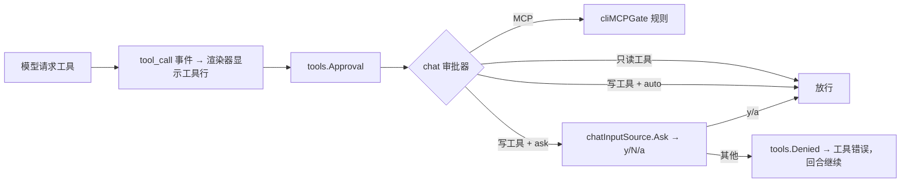

<!-- template_id: design; template_version: 1.1.1 -->
# Suag chat 写工具开关、交互确认与遗留小项 设计

> 状态：Draft 0.1 / 待人工计划批准

## 修订记录

| 版本 | 日期 | 作者 | 摘要 |
|---|---|---|---|
| 0.1 | 2026-10-09 | Claude | 初稿 |

> 仅语义变化递增版本；纯 identity/provenance/元数据纠正沿用原版本，并在 Git/进度记录中留痕。

## 背景与目标

思考模式 RIGOROUS；核心目标：让 chat 能安全地使用写文件与 shell 工具，并清理 `suag-iw3u` 中可在代码内完成的遗留项。scope freeze：下列三部分；review budget：一轮合并轴评审（低暴露度，SR1409）；停止条件：评审无 CORE_BLOCKING 且用户批准。

用户可见结果：

1. 配置 `tools.allow_write: true` 后，`suag run`/`suag chat` 不必每次加 `--allow-write` 就能使用 `file_write`、`shell_exec`（及配置了 `serpapi_key` 时的 `web_search`）。
2. chat 中模型调用 `file_write` 或 `shell_exec` 前，终端先显示调用内容并询问 `[y/N/a]`；拒绝时模型收到工具错误、回合继续。
3. 遗留小项：trace 显示计划；stream-json 输出工具调用与结果行；路径越界判断不再依赖错误文案；ACP 写入预览不会被特殊文件阻塞；ACP 回合提前失败时用量不再报 0；agentcore 工作记忆视图保留工具调用前的助手文字。

## 名词

- **写工具**：`file_write`、`shell_exec`。只读工具 `file_read`、`file_list`、`update_plan`、`tool_search` 不在此列。
- **交互确认**：chat 在执行写工具前，在终端向用户询问是否允许。

## 范围与非目标

范围：suag 仓库 `internal/{config,wiring,chat,cli,acpserver,platform/tools/native,personal}`、`pkg/agentcore/memory`、文档与样例。

非目标：

- 不改 MCP 工具的放行规则（`tools.auto_allow`/`read_only_allow` 不变；未放行的 MCP 工具仍直接拒绝，不在 chat 中询问）。
- 不改 ACP 的审批（ACP 已由客户端逐次审批）。
- 不新增局部编辑工具（`file_edit`）；不处理 Claude 思考内容回传（suag 未开启 Claude 思考模式）；Windows 人工确认项不在代码范围。

## 已确认事实与规范

- CLI 默认工具：`file_read`、`file_list`、`update_plan` 与配置的 MCP；`--allow-write` 时改为全部内置工具（`internal/wiring/runtime.go` `buildPersonalCLICapabilities` → `buildDefaultCapabilitiesWithServers`，含 `shell_exec` 与有 `serpapi_key` 时的 `web_search`）。
- 审批层：`tools.Approval` 在执行前调用 `Approver.Decide`；返回 `tools.Denied` 时模型收到工具错误、回合继续（同一回合累计 3 次拒绝结束回合）；其他错误中止回合（`internal/platform/tools/approval.go`）。CLI 现用 `cliMCPGate`，内置工具一律放行。
- chat 输入由 `chatInputSource` 管理：回合进行中读取器可能仍有一个挂起的读请求；socket 投递经 `deliveries` 通道进入（`internal/chat/chat_input.go`）。
- runner 在工具执行前发 `tool_call` 事件（`BeforeTool`），审批发生在其后的 `ExecuteTool` 中，因此渲染器先显示工具行，再询问。
- 遗留项出处：`suag-iw3u` 第 2、3、4、5、8、9 项；`isRootEscape` 匹配 "path escapes from parent"（`internal/platform/tools/native/pathresolve.go:73`），标准库未导出对应错误值；`toolDiff` 先 `Lstat` 再打开（`internal/acpserver/policy.go:255`）。
- 规范：SR1107（design→plan→实施）、SR1409（低暴露度一轮合并评审）、SR1403（最小充分）。

## 总体方案

### 1. `tools.allow_write`

- 布尔，缺省 false。为 true 时 run 与 chat 等同带 `--allow-write`。
- `--read-only` 优先：同时出现时按只读处理（只读是调用方的显式收紧，不被配置放宽）。
- ACP 不读此项（ACP 的写工具由会话模式与客户端审批决定）。

### 2. chat 交互确认

- 配置 `tools.approval`：`ask`（缺省）或 `auto`。只作用于 chat 中的写工具；`run` 是非交互的，`--allow-write`/`allow_write` 本身就是授权，不询问。
- chat 的审批器包装现有 `cliMCPGate`：MCP 工具规则不变；写工具在 `ask` 下询问，`auto` 下直接放行；只读工具直接放行。
- 询问方式：工具行已由渲染器显示，再显示一行 `允许执行 <工具名>？[y]是 [N]否 [a]本会话总是允许该工具：`。
  - `y`/`yes`：本次允许；`a`/`always`：本次及本进程后续同名工具都允许；其他任何输入（含空行）：拒绝，模型收到 `用户拒绝执行 <工具名>`。
  - Ctrl-C：按现有语义中断整个 chat（ctx 取消 → 审批中止）。
  - 询问期间到达的 socket 投递保持排队，回答后再按原逻辑处理。
- chat 的标准输入不是终端（管道、脚本）时无法询问：`ask` 下写工具一律拒绝，并提示设置 `tools.approval: auto`。
- 实现：`chatInputSource` 新增 `Ask(ctx, prompt) (string, error)`，复用现有读请求通道读取一行（若回合开始前已有挂起的读请求，则直接把它作为这次回答的读取并更新提示符）。

### 3. 遗留小项

| 项 | 做法 |
|---|---|
| trace 显示计划 | `suag trace` 在时间线中按时间输出 plan 条目：`plan ✔ 步骤 / ▶ / ○` |
| stream-json 工具事件 | 新增 `tool_call`（`name`、`args` 摘要）与 `tool_result`（`name`、`is_error`、`summary`）两种行；只新增行类型，已有行不变；golden 契约随之更新；Gofer 的 `ndjson_keep` 白名单不含它们，不受影响 |
| 路径越界判断 | 删除 `isRootEscape` 的文案匹配：`os.Root` 拒绝且不是 NotExist/权限错误时，一律进入现有 `realRelInRoot` 二次判定（它只在真实位置位于工作区内时放行，且随后仍经 `os.Root` 打开） |
| ACP 写入预览阻塞 | `toolDiff` 先打开再对已打开的句柄 `Stat`，只读取普通文件；Unix 下以非阻塞方式打开，避免 FIFO 在 open 时阻塞 |
| ACP 用量为 0 | 回合在 finish 前失败时，用 store 的会话累计用量填充 `usage_update`，不再报 0 |
| 工作记忆视图 | `pkg/agentcore/memory` 过滤工具消息时保留带工具调用的助手消息中的文字 |

## 架构

## 关键流程

chat 一轮中的写工具：模型返回 `shell_exec` → 渲染器打印 `⏺ shell_exec {...}` → 审批器询问 → 用户输入 `y` → 执行并打印结果行 → 模型继续；输入 `n` → 打印 `⎿ error: 用户拒绝执行 shell_exec`，模型收到拒绝后自行调整。

## 安全、数据、运维与回滚

- 安全：写工具的默认开启需要用户在配置中显式设置；chat 下缺省逐次询问，比现在 `--allow-write` 的“开了就全部放行”更严；无法询问时拒绝（fail closed）；只读模式始终优先。
- 契约：stream-json 只增加两种行类型；Gofer 端按白名单保留行，不受影响，会通知 gofer 会话。
- 回滚：各部分独立提交，可分别回退。

## 决策

- D1 `run` 不做交互确认（非交互，`--allow-write` 即授权），交互确认只在 chat。
- D2 `a` 的“总是允许”只在当前 chat 进程内有效，不写入配置。
- D3 未放行的 MCP 工具不纳入询问（保持现有放行模型，避免本批扩大审批范围）。

## 待确认事项

- Q1 `tools.approval` 缺省值：`ask`（推荐，开启写工具后每次询问）／`auto`（开启即全部放行，与现在 `--allow-write` 一致）。
- Q2 chat 标准输入不是终端时：拒绝写工具（推荐，fail closed）／按 `auto` 放行。

## 结论与人工计划 Gate

确认 Q1–Q2 并批准本设计后，编写实施计划；计划经一轮合并评审与人工批准后实施。
