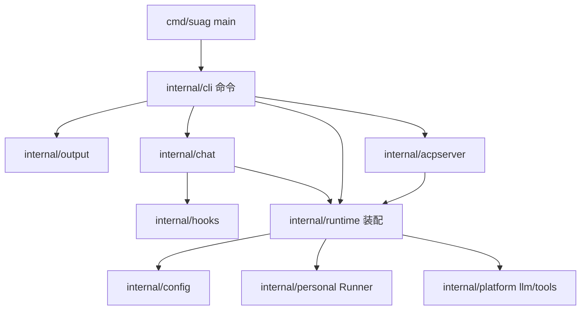

<!-- template_id: design; template_version: 1.1.1 -->
# Suag 配置重设计、分层整理与 chat 显示 设计

> 状态：Draft 0.1 / 待人工计划批准

## 修订记录

| 版本 | 日期 | 作者 | 摘要 |
|---|---|---|---|
| 0.1 | 2026-10-09 | Claude | 初稿 |

> 仅语义变化递增版本；纯 identity/provenance/元数据纠正沿用原版本，并在 Git/进度记录中留痕。

## 背景与目标

文档思考模式：RIGOROUS。核心目标：让 suag 的配置、代码结构和终端体验达到"可长期维护、对任何调用方中立"的状态。scope freeze：只覆盖下列四个 issue；review budget：一轮合并轴评审（低暴露度，SR1409）；停止条件：评审无 CORE_BLOCKING 且待确认项由用户决定。

用户可见结果：

1. **配置**（suag-kai3）：一个配置文件里定义多个 provider，用 `model: <provider>/<model>` 选默认模型；`--model` 同样写法切换。不再有"单个 `llm` 段 + `--provider` 覆盖时丢弃 key/base_url"的规则。
2. **中立**（suag-kai3 并入）：代码里不再写死 gofer。hooks、默认 MCP 放行、job 提示词、回复前缀都由配置或调用方参数给出；Gofer 通过自己的 agent 配置和用户的 suag 配置启用这些配合。
3. **分层**（suag-2zbi）：`cmd/suag` 只做装配；每个命令一处定义；chat 循环、hooks、运行时装配、输出格式各有归属包；行为不变。
4. **chat 显示**（suag-c7co + suag-l5i7 剩余）：chat 用 gookit/cliui 区分用户输入、模型回复、工具调用、计划、错误，每轮结束显示一行状态；Claude provider 也真正流式输出并支持 `base_url`。

## 名词

- **provider 条目**：`providers.<id>` 下的一组连接参数（协议类型、base_url、密钥、请求头、模型元数据）。
- **模型引用**：`<provider-id>/<model-id>`，如 `opencode-go/deepseek-v4-flash`。
- **hooks 命令**：chat 在会话开始、提交输入、工具结束、回合结束时调用的外部命令，事件为 Claude Code 兼容 JSON（现有协议不变）。

## 范围与非目标

范围：suag 仓库内的配置读取与样例、`cmd/suag` 与 `internal/app` 的重组、chat 渲染、Claude provider 流式与 base_url、相关文档（README、`docs/usage/*`、config 样例）。

非目标：

- 不改会话存储、stream-json 与 ACP 协议字段（golden 契约测试保持不变）。
- 不改 Gofer 仓库；需要 Gofer 侧调整的配置以"迁移说明"交给 gofer 会话。
- 不做多模型路由、按任务自动选模型、provider 的 `models.list` 在线发现。
- `suag-iw3u` 的遗留小项不在本批（Claude thinking 回传仍 deferred：suag 未开启 Claude extended thinking）。

## 已确认事实与规范

- 当前配置键（代码中全部读取点）：`llm.{api_type,provider_name,model,api_key,base_url,compact_model,context_window,headers}`、`max_steps`、`workspace`、`serpapi_key`、`mcp.servers`、`tools.{deferred,auto_allow}`、`transcripts`、`gofer.{hooks,command,agent,wait_sec,timeout_ms}`；env：`SUAG_MODEL`、`SUAG_PROVIDER`、`SUAG_GOFER_HOOKS`、`GOFER_JOB_ID`。
- gofer 写死行为四处：`internal/app/gofer_hooks.go`（调用 `gofer hook`）、`internal/app/cli_mcp.go` 的 `defaultMCPAutoAllow`、`internal/personal/runner.go` 的 GOFER_JOB_ID 提示词、`[gofer web 回复]` 前缀（`chat.go`/`chat_input.go`/`runner.go`）。
- 规模：`cmd/suag` 2 个文件 537 行，其中直接定义了 acp/version/ps/send/trace 命令和 `runTrace`；`internal/app` 8 个文件约 1900 行，混合了命令定义（`NewPersonalCommand`）、运行时装配（`openPersonalRuntimeConfigured`）、stream-json 输出、chat 循环、hooks、MCP 审批。
- Claude provider 使用固定 `claudeAPIBase`，不读 `base_url`；`Stream` 先 `Generate` 再一次性输出。OpenAI 兼容 provider 已在 1bf358c 改为 SSE 真流式。
- OpenCode Go 的 Qwen/MiniMax/Claude Haiku 模型走 Anthropic `/v1/messages`，需要 Anthropic 协议 + 自定义 base_url。
- 规范：SR1107/SR1207（design→plan→实施）、SR1409（低暴露度一轮合并评审）、SR1403（最小充分）、GR104（单文件 ≤1000 行）。

## 总体方案

### 1. 配置格式

保留 YAML 与 gookit/config（`${VAR}` 展开、`SUAG_HOME/.env` 不变）。参考 opencode 的 `provider/model` 引用和 codex 的 `model_providers`：

```yaml
model: opencode-go/deepseek-v4-flash      # 默认模型引用（必填）
compact_model: opencode-go/glm-5.3-flash  # 可选：摘要用模型引用
fallback_models: [deepseek/deepseek-chat] # 可选：按序备用

providers:
  opencode-go:
    type: openai                          # 协议：openai | anthropic
    base_url: https://opencode.ai/zen/go/v1
    api_key: ${OPENCODE_API_KEY}
    headers:
      x-opencode-session: "<会话 ID 占位符>"  # 现有 headers 占位符语法不变
    models:                               # 可选：模型元数据
      deepseek-v4-flash: {context_window: 128000}
  opencode-go-anthropic:
    type: anthropic
    base_url: https://opencode.ai/zen/go
    api_key: ${OPENCODE_API_KEY}
  deepseek:
    type: openai
    base_url: https://api.deepseek.com/v1
    api_key: ${DEEPSEEK_API_KEY}
```

规则：

- 内置三个 provider 预设 `openai`、`anthropic`、`deepseek`（默认 base_url 与密钥环境变量 `OPENAI_API_KEY` / `ANTHROPIC_API_KEY` / `DEEPSEEK_API_KEY`）；用户同名条目逐字段覆盖预设。其他 provider 必须写 `type`。
- `--model` 与 `SUAG_MODEL` 接受 `provider/model`；只写 `model`（不含 `/`）时沿用默认模型的 provider。优先级：flag > env > 配置。
- 删除 `--provider`、`SUAG_PROVIDER`、`llm.*` 整段；读到旧 `llm` 段时启动报错并给出新写法提示（不自动迁移，见待确认 Q1）。
- `context_window`：`providers.<id>.models.<model>.context_window` > 内置按模型名推断。
- 其余顶层键保留：`max_steps`、`workspace`、`serpapi_key`、`mcp.servers`、`tools.{deferred,auto_allow}`、`transcripts`。

### 2. gofer 行为改为通用配置

| 现状 | 新做法 | Gofer 侧配合 |
|---|---|---|
| chat 自动调用 `gofer hook`，`gofer.*` 配置 | `hooks.command: [gofer, hook, suag]`（argv 数组）、`hooks.timeout_ms`、`hooks.stop_wait_sec`、`hooks.tool_name_alias: {shell_exec: shell}`；未配置即关闭；`SUAG_HOOKS=off` 临时关闭 | 用户 suag 配置写 `hooks.command`；Gofer 拉起的非交互 job 设 `SUAG_HOOKS=off`（替代 suag 内对 `GOFER_JOB_ID` 的判断） |
| 默认放行 `gofer/...` 查询工具 | 内置默认放行为空；`tools.auto_allow` 由配置给出 | 用户 suag 配置写 gofer 查询工具的放行规则（样例给出） |
| `GOFER_JOB_ID` 时追加汇报提示词 | 删除；提示由调用方经 `--append-system-prompt` 给出 | Gofer 在 job 的 system_prompt 中加入该句 |
| `[gofer web 回复]` 前缀、`from=gofer` 映射 | 投递来源标签通用化：前缀为 `[来自 <from>] `，`<from>` 来自 `suag send --from` 或 hooks 响应里的 `source` 字段（缺省 `外部`） | `deliver_command` 加 `--from "gofer web"`；hook 响应带 `source` |

`internal/personal` 不再出现 gofer 字样；`injected` 判定只依据调用方传入的 `Injected` 标志。

### 3. 分层

目标结构（只移动与拆分，不改行为）：

```text
cmd/suag/main.go            装配：加载配置 → 构建命令树 → 运行 → exitReport
internal/cli/               命令定义：每个命令一个文件（run chat acp ps send trace stats export version），
                            只做 flag 解析、调用下层、选择输出格式
internal/runtime/           运行时装配：由配置构建 provider/pool、工具、MCP、审批、Runner（原 openPersonalRuntimeConfigured 等）
internal/output/            run 的输出：stream-json 编码、文本实时输出（liveText）、usage 形状
internal/chat/              chat 循环、输入源、投递队列、渲染（cliui）
internal/hooks/             通用 hooks 客户端（原 gofer_hooks.go）
internal/config/            新配置模型与读取
internal/personal、platform、acpserver、capability   保持
```

`internal/app` 拆完后删除。每个新包只依赖下层：`cli → runtime/chat/output/hooks → personal/platform/config`。

### 4. chat 显示与 Claude 流式

- 渲染器（`internal/chat/render.go`）基于 gookit/cliui 与 gookit/color：用户提示符着色；模型文本实时打印；工具调用显示为一行 `⏺ file_read path=...`，结果摘要一行（超长截断）；`update_plan` 显示勾选列表；错误红色；每轮结束一行灰色状态 `model · in/out tokens · 耗时`。非 TTY 或 `NO_COLOR` 时退化为纯文本。
- 需要的事件：runner 现有 `tool_result`（仅 hooks 开启时发）改为 chat 始终订阅，并新增 `tool_call` 开始事件；stream-json 不输出这两类事件（契约不变）。
- Claude provider：读取 `base_url`；`Stream` 用 Messages API `stream: true` 解析 `content_block_delta`（text、input_json_delta）、`message_delta`（usage、stop_reason）；只重试建连；与 OpenAI 实现同样的"已输出则不切换备用"。

## 架构



## 关键流程

模型选择：`--model`/`SUAG_MODEL`/`model` → 解析为 `(provider, model)` → 合并预设与用户条目 → 按 `type` 构建 provider（携带 base_url、key、headers）→ 与 `fallback_models` 组成 Pool；`compact_model` 单独构建。

chat 一轮：输入 → 渲染器打印提示 → Runner 事件流（文本增量 / tool_call / tool_result / plan）→ 渲染 → 回合结束状态行 → hooks Stop（若配置）。

## 安全、数据、运维与回滚

- 数据：会话库与 stream-json/ACP 契约不变；旧会话可继续使用。
- 配置：旧 `llm` 段不再生效，升级后需按提示改写配置（Gofer 主机与本机各一份）；回滚到旧二进制即恢复旧配置读取。
- 安全：默认 MCP 放行变为空，比现状更严；hooks 默认关闭，只执行配置里的 argv（不经 shell）。密钥仍只来自配置/`.env`/环境变量，不进 argv。
- 回滚：每个阶段独立提交，可按阶段回退。

## 决策

- D1 YAML + `provider/model` 引用 + 内置三个预设（理由：沿用现有加载与 `.env` 机制，用户只学一种写法）。
- D2 先分层（纯移动、行为不变），再改配置，再做 chat 显示；Claude 流式与它们无依赖，可并行。
- D3 gofer 配合全部经配置和调用方参数表达，suag 内置默认对 Gofer 无特殊对待。

## 待确认事项

- Q1 旧 `llm` 段：直接报错并提示新写法（推荐，无历史包袱）／读取时自动转换为新结构。
- Q2 删除 `--provider` 与 `SUAG_PROVIDER`，只用 `--model provider/model`（推荐）／保留 `--provider` 作为选择 provider 的简写。
- Q3 Gofer 侧配合（`SUAG_HOOKS=off`、system_prompt 汇报句、`--from "gofer web"`、hook 响应 `source`）与 suag 同批交付，由 gofer 会话在 Gofer 仓库实施（推荐）／suag 先保留兼容读取 `GOFER_JOB_ID` 一个版本。

## 结论与人工计划 Gate

确认 Q1–Q3 并批准本设计后，进入实施计划编写；计划经一轮合并评审与人工批准后才实施。
