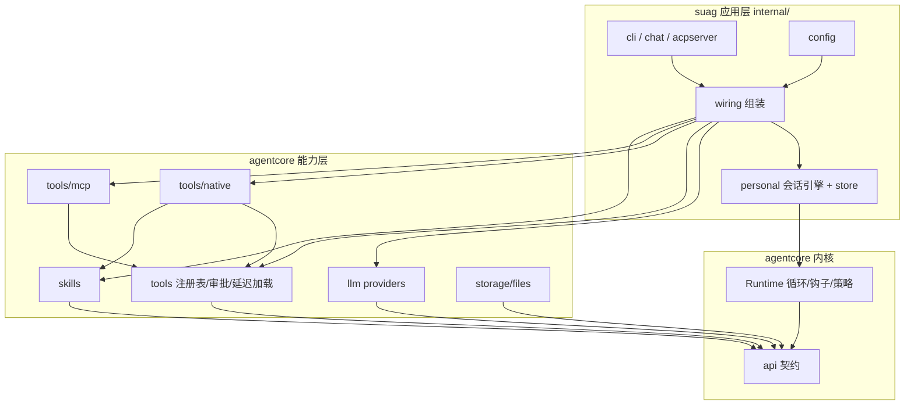

<!-- template_id: design; template_version: 1.1.1 -->
# agentcore 独立分层：核心下沉与清理 设计

> 状态：Draft 0.2 / 待人工计划批准

## 修订记录

| 版本 | 日期 | 作者 | 摘要 |
|---|---|---|---|
| 0.1 | 2026-10-10 | Claude | 初稿 |
| 0.2 | 2026-10-10 | Claude | 按合并评审修订：根包不再导出 Registry、不 import tools，工具注册表统一接收 `api.Tool`（Kind 为可选接口），公开 API 以“干净断开 + 删除记录”代替别名（F1）；默认内存存储的语义与受影响测试（F2）；mcp 配置解耦含调用超时并补 cli/acpserver 范围（F3）；IsError 兼容改为统一解码与双写（F4）；运行用量字段放在 personal.RunResult（F5）；W4 补 skill、改为按 Tool 判定、native 只给中性类别（F6）；逐个示例处置（F7）；文档范围与历史文档不改（F8）；mock 增加命名与错误排队（F9）；守卫含测试依赖并精确匹配（F10）；最小示例默认只读（F11） |

> 仅语义变化递增版本；纯 identity/provenance/元数据纠正沿用原版本，并在 Git/进度记录中留痕。

## 背景与目标

思考模式 RIGOROUS；核心目标：让 `pkg/agentcore` 成为可独立使用、层次清楚、接口稳定的 Agent 内核库——通用能力（LLM provider、工具层、内置工具、MCP 客户端、skills）下沉到 agentcore，suag 只保留应用层（会话、配置、终端、ACP、CLI）；同时删除无人使用或过时的代码、示例与文档，并为有参考价值的删除项留下可找回的记录。scope freeze：下列 W1–W5；review budget：一轮合并轴评审（低暴露度，SR1409：个人项目、未投产、可回滚）；停止条件：评审无 CORE_BLOCKING 且用户批准。

用户原话（2026-10-10）：“希望是可以成为独立的 pkg，即使是只给 suag 用也应该将核心下沉，保持稳定，避免代码没有层次后续难以维护；可以清理一些过时的文档/example/代码等，觉得有用的留个记录，方便后面找回参考；要做”。

用户可见结果：

1. `pkg/agentcore/...` 不引用任何 `internal/`，由测试守住；另一个 Go 程序只依赖 agentcore 就能组装出“provider + 工具 + 审批 + MCP + skills”的 Agent。
2. suag 行为不变：`go test -race ./...`、`make smoke-chat` 与主机 Windows 测试全部通过，CLI/ACP/chat 输出与配置不变。
3. 同一概念只有一份实现：一份工具注册表、一份用量累加、一份“只读/是否 MCP”判断。
4. 代码与文档减量：删除死代码与过时设计文档，删除记录集中在一份索引里，可按提交找回。

## 名词

- **内核层**：`pkg/agentcore` 根包与 `api`——模型/工具循环、钩子、策略、契约类型。
- **能力层**：agentcore 下的可选子包——`llm`、`tools`、`tools/native`、`tools/mcp`、`skills`、`storage/files`、`mock`、`testing`。
- **应用层**：suag 的 `internal/`——配置、会话引擎（personal/store）、wiring、chat、acpserver、cli、hooks（用户 shell 钩子）、output。
- **删除记录**：`docs/archive/removed-2026-10.md`，逐项写“删了什么、原用途、删除前提交、如何找回（`git show <commit>:<path>`）”。

## 范围与非目标

范围：仓库 `inhere-tools/suag` 的 `pkg/agentcore/**`、`internal/platform/**`、`internal/capability/**`、`internal/wiring/**`、`internal/config/**`（MCP 设置转换处）、`internal/personal/**`、`internal/acpserver/**` 与 `internal/cli/**`（用量、工具判定与 MCP 设置的调用点）、`internal/chat/**`（用量累加点）、`docs/usage/**`（含 `llm-mock-usage.md`）、文档 `pkg/agentcore/README.md`、`pkg/agentcore/docs/**`、`docs/archive/**`、`AGENTS.md` 与 `README*.md` 的结构说明、CI 工作流。

非目标：修改历史设计与计划文档（`docs/design`、`docs/plans` 中的旧路径保持原样，删除记录给出新旧路径对照）；拆成独立 Go module 或独立仓库（见 Q3）；改变 suag 的用户行为、配置格式或数据库结构（`ToolResult.IsError` 让新写入的消息 JSON 多一个键，旧数据兼容读取，回滚仍可读）；把会话策略（拒绝计数、压缩、交接、项目规则）下沉；删除内核的 resume/authority/Artifact 语义（有完整测试、属内核公开语义）；重写 `personal`（只做同包内的函数拆分，见 W5）。

## 已确认事实与规范

（R = 仓库根；分析于 2026-10-10，HEAD `v0.8.0-1-g3558148`；独立只读分析报告的关键项已抽查核实。）

| 项 | 事实 |
|---|---|
| 依赖方向 | agentcore 生产代码不引用 `internal/`；唯一例外是 `_examples/bridge/main.go:10-11` |
| 可下沉包 | `internal/platform/llm`（1826 行，只依赖 `api`）、`internal/platform/tools`（869 行，只依赖 `api`）、`internal/capability/skills`（361 行，无依赖）、`internal/platform/tools/native`（2655 行，依赖 tools、skills）、`internal/platform/tools/mcp`（619 行，另依赖 `internal/config` 的设置类型与 runtimecaps） |
| 死代码 | `internal/capability/runtimecaps`（Manager 生产代码只创建不读取）、`pkg/agentcore/hooks`（与 `runtime_helpers.go:374-447` 逐行相同，仅自测使用）、`pkg/agentcore/storage/sqlite`（仅自测）、Embedding 链（`api.EmbeddingProvider` 与 3 处 `Embed`，无调用方）、`tools.Registry.Subset/Execute`、未用的 `Kind` 常量 |
| 无使用者子包 | `pkg/agentcore/context`（279 行）、`memory`（202 行）、`prompt`（94 行）只被 `_examples` 使用 |
| 重复 | 两套工具注册表（`agentcore/tools.go` 与 `internal/platform/tools/registry.go`）；两个 mock provider（`agentcore/mock` 与 `internal/platform/llm/mock.go`）；用量累加 4 处（`runtime.go:174`、`personal/usage.go:52`、`acpserver/usage.go:25`、`chat/chat.go:476`）与两个逐调用收集器；只读工具清单 3 份（`native/catalog.go`、`wiring/chat_approver.go:21`、`acpserver/policy.go:334`）；“是否 MCP”判断 5 处 |
| 字符串约定 | 工具出错标记靠 `Metadata["is_error"]` 跨 5 个文件传递，且是公开约定（`llm/claude.go:115-118`）；解码路径至少 `store/agentstore.go:77,122`、`personal/context.go:100`、`storage/files`；`"tool_error"` 键无读取者 |
| 注册表差异 | 根包 Register 同名覆盖、允许 nil、未注册返回 `*ToolError`（`tools.go:24-36,82`）；`internal/platform/tools` 要求 `Kind()`、同名 panic、未注册返回普通 error（`registry.go:51,72,76,113`）；根包只在 `runtime_helpers.go:37-41` 用默认空注册表；`tools/registry_test.go` 依赖 `agentcore/testing`（会与根包形成测试循环） |
| 默认存储使用者 | `runtime_test.go:89-92`（断言 `*files.Storage`）、`:853-881`（非法 runID 报 `*StorageError`）、`runtime_resume_test.go:166` 与全部示例用 `FileStorage` 别名；suag 总是显式传入 Storage（`personal/runner.go:405`） |
| MCP 配置 | `mcp/provider.go:63` 读全局配置 `MCPCallTimeout()`；`MCPServerSettings` 还被 `acpserver/server.go:52,56,318`、`policy.go:357-377`、`cli/acp.go:33` 使用 |
| 示例 | 13 个 `_examples` 当前都能 `go vet`；其中 context、host、memory、prompt、recommended 依赖 Q1 拟删的子包 |
| 默认存储 | 根包经 `types.go:94-100` 别名与 `runtime_helpers.go:30-34` 硬绑定 `storage/files`，未传 Storage 时静默写 `os.TempDir()` |
| 文档 | `pkg/agentcore` 文档 7183 行（README 538、docs 23 篇），内含 8 篇设计/路线类长文；README 引用的 `examples/` 实为 `_examples/`（不参与编译） |
| 规范 | SR1403/SR1405（不做→复用→最小实现）、SR1405.1（扩围需两个用例或用户明确要求平台化——本次用户明确要求）、GR104、GR106 |

## 总体方案

目标结构：

```text
pkg/agentcore                 内核：Runtime、钩子链、执行策略、authority（不变）
pkg/agentcore/api             契约：Message/Tool/Provider/Storage…（+Usage.Add、ToolResult.IsError、运行用量统计）
pkg/agentcore/llm             OpenAI 兼容 / Anthropic provider、Pool 回退（原 internal/platform/llm）
pkg/agentcore/tools           工具注册表（含 Kind 与 Lookup）、审批层、延迟加载 + tool_search、Asker（原 internal/platform/tools，并取代根包 Registry）
pkg/agentcore/tools/native    内置开发工具与工具清单元数据（原 internal/platform/tools/native）
pkg/agentcore/tools/mcp       stdio MCP 客户端（原 internal/platform/tools/mcp，配置类型改为本包自有）
pkg/agentcore/skills          SKILL.md 解析、注册与检索（原 internal/capability/skills）
pkg/agentcore/storage/files   文件存储（保留；不再被根包硬绑定）
pkg/agentcore/mock、testing    测试替身与一致性套件（合并 llm mock）
internal/…                    suag 应用层：config、wiring、personal(+store)、chat、acpserver、cli、hooks、output
```

### W1 清理与删除记录

删除：`internal/capability/runtimecaps` 及其接线（含 wiring 的 `capabilityToolProvider` 嵌入与 mcp 的 `ListToolRefs`，须先于 mcp 下沉）；`pkg/agentcore/hooks`；`pkg/agentcore/storage/sqlite`；Embedding 链；`internal/platform/llm/mock.go`（测试改用 `agentcore/mock`，后者增加可设名字与错误排队的选项以覆盖 `personal/observe_test.go` 的用法；同步改写 `docs/usage/llm-mock-usage.md`）；注册表死方法与未用 `Kind`；`_examples/bridge`；`"tool_error"` 死键；按 Q1 处理 `context`、`memory`、`prompt` 三个子包。

示例：从 `_examples/` 移到 `examples/` 并参与编译与 CI（`go vet ./...`）。逐个处置（按 Q1 推荐）：保留 minimal、custom、authority、policies、policyhost、resume、stream；改写 host、recommended，去掉对 context/memory/prompt 的依赖，并改用下沉后的 `llm`、`tools`；删除 context、memory、prompt（随子包删除）与 bridge（反向依赖 internal），均记入删除记录。

文档：`pkg/agentcore/docs` 只保留与现状一致、对使用者有用的篇目（README、architecture、api、getting-started、host-integration、runtime-policies 按新结构改写）；设计/路线/发布准备类长文移到 `docs/archive/agentcore-2026-10/` 原样保存；删除记录索引列出每项。

### W2 契约加固（api）

- `api.Usage.Add(other)`，替换 4 处手写累加。
- `personal.RunResult` 增加最后一次请求的输入 token 与模型调用次数，由已有的 `usageCollector` 在 finish 中填入（取消回合时 agentcore 可能不返回结果，collector 仍有数据）；ACP 删除自有收集器 `turnUsage` 改用该结果，并补“取消回合仍上报用量”的测试。agentcore.RunResult 不变。
- `api.ToolResult.IsError bool` 取代 `Metadata["is_error"]`：`ToolResult.UnmarshalJSON` 统一兼容旧数据（`Metadata["is_error"]==true` 视为 `IsError`）；一个版本内写入方同时写两种标记、读取方判断 `IsError || Metadata["is_error"]==true`；删除 `"tool_error"` 死键；补旧 JSON 往返测试。

### W3 能力下沉

- 依赖顺序：`skills` → `llm` → `tools` → `tools/native` → `tools/mcp`。每步一次移动提交（`git mv` 保留历史），只改导入路径与必要的导出名，不改行为。
- 工具注册表：根包不再导出 `Registry`/`NewRegistry`，也不 import `tools`；`runtime_helpers.go` 的默认注册表改为根包私有的空实现（行为同现在：无工具、未注册返回 `*ToolError`）。`tools.Registry` 改为接收 `api.Tool`，`Kind()` 改为可选接口（缺省视为 native），保留现有“Register 同名 panic、TryRegister/MustRegister 不覆盖/覆盖”的语义与未注册时的普通 error。依赖 `agentcore/testing` 的 tools 测试改为外部测试包 `tools_test`。这一替换是行为变化，单独提交，不混入移动提交。
- 公开 API 兼容策略：目前没有第二个使用者，删除或改名的公开符号（根包 `Registry`、`FileStorage`/`NewFileStorage` 别名、`hooks` 包、`storage/sqlite`、Embedding 等）不留别名，统一记入删除记录并给出替代用法。
- `tools/mcp` 的设置改为本包 `ServerSettings`（含 `CallTimeout`，不再读全局配置）；`internal/config` 负责读取并填值，acpserver 与 cli 中的 `MCPServerSettings` 用法同步改为新类型；mcp 测试改用本包类型，避免 config↔mcp 测试循环。
- 根包不再依赖 `storage/files`：未传 Storage 时使用根包内存实现，同时实现 `Storage` 与 `ArtifactStorage`，沿用 files 的 runID 校验（非法 runID 仍报 `*StorageError`）；改写 `runtime_test.go:89-92` 的类型断言；删除 `FileStorage`/`NewFileStorage` 别名，测试与示例改用 `files.NewStorage`；README 写明“默认不持久化，跨实例续跑需显式传入文件存储”。

### W4 应用层去重

- 工具元数据：native 提供中性类别（read/edit/execute/search/fetch/think）与只读标记，作为工具的可选接口；不在 Catalog 中的 `update_plan`、`tool_search`、`skill` 由各自工具实现同一接口。chat 免确认集合由“只读”派生；ACP `toolKind` 在 acpserver 内把中性类别映射为 `acp.ToolKind`（ACP 概念不进 agentcore）。`BeforeTool` 阶段只有名字时，经注册表 `Get` 取工具再读元数据；取不到的未知工具保持 Other 并询问（fail-closed）。
- `tools.IsMCP(tool)` 与 `tools.MCPServerOf(tool)` 替换 4 处按 Tool 的判断与 2 处重复的取 server 名逻辑；`cli/acp.go` 的按名判断先 `Get` 再调用。
- 先单独提交表格测试，再改实现：行取“旧硬编码集合 ∪ Catalog ∪ 未知工具名 ∪ 与内置同名的 MCP 工具”，列覆盖 nil tool、read_only、chat ask/auto/always、CLI `read_only_allow`；实现改完后表格不变即行为不变。

### W5 护栏与文档

- 架构守卫测试：`go list -deps -test ./pkg/agentcore/...` 的结果中不得出现以 `github.com/inhere/suag/internal/` 开头的包（按完整前缀匹配，`pkg/agentcore/internal/utils` 合法）。
- `personal/runner.go` 的 `Run` 在同包内拆出 transcript 回放与钩子组装两个函数（不改行为、不建新包）。
- 更新 `pkg/agentcore/README.md`（分层图与“最小可运行 Agent”示例；示例默认只读工具，写工具示范经 `tools.NewApproval` 包装）、`AGENTS.md`、`README*.md` 的结构说明。

## 架构



## 关键流程

- 嵌入方（非 suag）：`llm.NewOpenAI(...)` + `tools.NewRegistry()` 注册 `native.BuildTools(env, false)`（只读）+ `agentcore.New(Config{Provider, Tools})` → `Run`；需要写工具时以 `tools.NewApproval` 包装后再开启。
- suag：wiring 读配置 → 用能力层构建 provider、工具栈（observe→visibility→approval→base）、skills → 交给 personal 会话引擎；行为与现在一致。

## 安全、数据、运维与回滚

- 权限相关：W4 改动只读集合与 ACP 种类的来源，靠“先补表格测试再改实现”保证判定不变；任何差异即停止。
- 数据：`IsError` 经统一解码兼容已存消息，不迁移数据库；新写入同时保留 `Metadata["is_error"]` 一个版本（JSON 多一个 `IsError` 键），回滚到旧版本仍能读。
- 嵌入方语义：根包默认存储改为内存后，只传 provider 的嵌入方不再跨实例续跑（suag 不受影响，总是显式传入存储）。
- 运维：无配置变化；主机 `make install` 与真实 provider 回归一次。
- 回滚：每个 W 分步提交，可按提交回退；删除项可按删除记录用 `git show` 找回。

## 决策

- D1 agentcore 定位为可独立使用的库，仍在本仓库同一 module（`pkg/agentcore`），由守卫测试保证独立性。
- D2 能力层下沉以“只依赖 api / 无 suag 概念”为准；会话策略留在应用层。
- D3 移动提交与行为修改提交分开；移动只改导入路径。
- D4 工具注册表只有 `tools.Registry` 一套公开实现，接收 `api.Tool`；根包只保留私有空默认实现，不 import 能力层。
- D7 公开 API 不留兼容别名，统一“干净断开 + 删除记录”。
- D5 删除优先于移动；有参考价值的删除项记入删除记录，过时设计文档原样归档而非改写。
- D6 根包不再隐式写临时目录。

## 待确认事项

- Q1 `context`、`memory`、`prompt` 三个无使用者子包：推荐删除并记入删除记录（约 575 行代码、800 行测试，相关设计文档归档）；备选：保留并标 experimental，让其示例参与编译。
- Q2 内置工具（`tools/native`）是否下沉：推荐下沉（独立 Agent 需要开箱即用的开发工具，且它只依赖 tools/skills）；备选：留在 suag，agentcore 只提供工具框架。
- Q3 独立 Go module：推荐本次不拆（守卫测试已保证可拆），待有第二个使用者时再拆为 `github.com/inhere/agentcore`；备选：本次即拆。

## 结论与人工计划 Gate

待用户批准设计（含 Q1–Q3）后编写实施计划；批准设计不授权实施。
