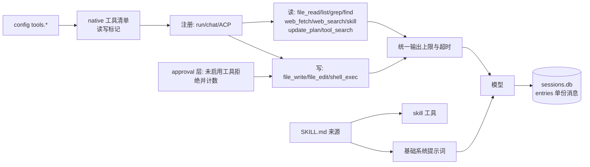

<!-- template_id: design; template_version: 1.1.1 -->
# 开发基础工具与 skills 跑通 设计

> 状态：Draft 0.2 / 已批准进入计划（2026-10-10 用户：“批准设计并开始写计划”，Q1–Q4 按推荐；W7 为用户同日提出的 DB 优化）

## 修订记录

| 版本 | 日期 | 作者 | 摘要 |
|---|---|---|---|
| 0.1 | 2026-10-10 | Claude | 初稿 |
| 0.2 | 2026-10-10 | Claude | 按合并评审修订：PowerShell 编码与退出码、整组终止实现约束与超时保留部分输出、只对“已知但未启用”的工具计数拒绝、web_fetch 改为拨号时校验、grep/find 走 OpenRoot、file_read 行边界截断、W3 接入点与稳定性表述、审批与分类改动点、只读注册收口、skills 优先级与旧测试处理、事实表纠正；记录 Q1–Q4 决议；新增 W7（运行状态不重复存消息）；分两阶段实施 |

> 仅语义变化递增版本；纯 identity/provenance/元数据纠正沿用原版本，并在 Git/进度记录中留痕。

## 背景与目标

思考模式 RIGOROUS；核心目标：让 suag 在 chat、`run`（gofer 拉起）与 ACP 下都具备开发常用的基础工具，工具行为可预期、不挂住、输出有界，skills 真正可用，再交给 gofer 日常使用。scope freeze：下列 W1–W7；review budget：一轮合并轴评审（个人工具、未投产，低暴露度，SR1409，已完成）；停止条件：计划评审无 CORE_BLOCKING 且用户批准。

用户可见结果：

1. 模型能搜内容（`file_grep`）、按模式找文件（`file_find`）、按字符串精确修改（`file_edit`）、抓取网页正文（`web_fetch`），大文件按行分段读取。
2. `shell_exec` 在 Windows 上可用、中文不乱码、超时一定生效且保留已有输出，输出有上限并附退出码。
3. 模型从第一轮就知道自己在什么系统、什么目录、是只读还是可写；调用当前没开的工具时得到原因和开启方法，而不是空转。
4. `~/.agents/skills` 等目录下的标准 SKILL.md 对模型可见、可按需加载正文。
5. 会话库不再重复保存消息，体积约减半。

## 名词

- **只读/写工具**：沿用现有分类；写工具只在 `--allow-write`（run）、`tools.allow_write`（chat）、ACP 非 read_only 时注册。
- **输出上限**：单次工具结果写入会话的最大字节数（按 UTF-8 边界切）。它会永久截断存储内容，与上下文构建阶段只作用于视图的截断（`personal/context.go:259-260` 的 16000→2000 阶梯）是两层，互不冲突。
- **基础系统提示词**：进程启动时生成一次的环境说明，接入 `personal.Config.PromptBuilder`。

## 范围与非目标

范围：仓库 `inhere-tools/suag`——`internal/platform/tools/native/`、`internal/platform/tools/`（registry/approval）、`internal/wiring/`（注册、提示词、skills 来源）、`internal/capability/skills/`、`internal/acpserver/policy.go`、`internal/wiring/chat_approver.go`、MCP client、`internal/personal/store/agentstore.go`（W7）、README 与 `docs/usage/`。

非目标：后台/常驻 shell、子 agent、向量检索式工具搜索、Claude 思考内容、gofer 侧配置改动（文档中给建议，由 gofer 会话落实）、按 skill 自动收窄工具集、`tools.shell=cmd`、grep 的 `count` 输出与上下文行、chat 中的完整 diff 渲染、会话明细改存 jsonl。

## 已确认事实与规范

（R = 仓库根，N = `R/internal/platform/tools/native`；盘点于 2026-10-10，HEAD 749f73f。）

| 项 | 事实 |
|---|---|
| 现有工具 | `file_read`(path)、`file_list`(dir，单层)、`file_write`(整文件覆盖)、`shell_exec`(command，超时 30s 写死，`code_exec.go:15,49`，`capabilities.go:49`)、`web_search`(SerpAPI，num 为 string)、`update_plan`、`tool_search`(仅存在 deferred MCP 时) |
| 注册条件 | 无写权限时 chat/run 只有 file_read/file_list/update_plan + MCP；ACP read_only 完全不注册 MCP（`runtime.go:290-300`）；只读模式的工具名硬编码在 `runtime.go:294-299`，写模式在 `capabilities.go:45-53`；`web_search` 仅写模式且有 `serpapi_key` 时注册 |
| 输出 | native 工具全部无上限，`len()` 按字节；只在上下文超阈值时于构建阶段截断视图 |
| shell | 固定 `sh -c`（`code_exec.go:64`），Windows 无 sh 即失败；超时只杀 sh、未设 `WaitDelay`/进程组；超时时丢弃全部输出（`code_exec.go:83-86`）；输出原样当字符串（`:67-81`） |
| 依赖 | `golang.org/x/sys`（`go.mod:13`，`windows` 包已在 `personal/process/process_windows.go:20` 使用）、`golang.org/x/text`（`go.mod:15`）已是直接依赖；`golang.org/x/net` 不在 go.mod |
| 越界 | 文件工具先词法检查再 `os.OpenRoot`（`file.go:175-270`）；shell 只设 cwd |
| 提示词 | 未设置 PromptBuilder（`runtime_helpers.go:361-363`）；PromptBuilder 在 `runner.go:402,680-698` 组合于项目规则、追加提示和 deferred 列表之前，每回合按进程配置生成，不存会话 meta |
| 缺工具 | 未注册工具得到 "not found"（`registry.go:107-114`），不计入拒绝；拒绝满 3 次结束回合，结束语为“等待授权”（`denial.go:16,107`）；未加载的 deferred MCP 工具在 `visibility.go:268-286` 已返回，到不了 approval 层（`approval.go:67-71`） |
| 审批/分类 | chat 免确认白名单 4 个工具（`chat_approver.go:21-23`），询问只显示路径与字节数；ACP `toolKind` 在 `policy.go:319-342`，已预留 `web_fetch` 为读；`toolDiff` 只读 `args["content"]`（`policy.go:259`） |
| MCP | `tools/call` 无单次超时（`client.go:362-366`），`call` 遵守 ctx（`client.go:229-231`） |
| skills | `buildDefaultSkillRegistry` 无非测试调用方；解析器按 `"\n---\n"` 切块逐块当 YAML（`parser.go:34`），带正文的 SKILL.md 确定失败且被吞掉（`parser.go:46-47`，`skills.go:68-71`）；先注册者胜出（`registry.go:21-24`），home 先加入（`skills.go:40-47`），测试断言用户目录胜出（`capabilities_test.go:202-224`）；另有按进程 CWD 的 `config/skills` 来源（`skills.go:49`）；工具需求靠描述关键词猜测（`loader.go:86-107`），`resolver.go` 无非测试调用方 |
| DB（主机实测） | `sessions.db` 1.58MB：15 会话、33 回合；`turns.state_json` 0.55MB ≈ `entries` 0.54MB，因 `RunState.Messages` 与已写入 entries 的消息重复（`agentstore.go:45-53`）；entries 中工具结果 64 条占 0.47MB |
| 规范 | SR1402.1（外部进程/网络/终端改动须真实验证）、SR1403、GR104（单文件≤1000 行）、GR106 |

## 总体方案

### W1 新增工具

| 工具 | 分类 | 参数 | 行为要点 |
|---|---|---|---|
| `file_grep` | 读（ACP Search） | `pattern`(RE2)、`path`、`glob`、`ignore_case`、`output`(`content`/`files`)、`max_results`(默认 100，上限 1000) | 纯 Go；遍历与读取都经 `os.OpenRoot`，跳过 symlink；跳过 `.git`、`node_modules`、`vendor`、`dist` 与根 `.gitignore` 的简单模式（尽力支持：不支持取反与嵌套 `.gitignore`）；前 8KB 含 NUL 视为二进制跳过，>1MB 跳过；结果为 `/` 分隔的相对路径 `path:line: text`；10s 超时返回已有结果并注明“已超时，结果不完整” |
| `file_find` | 读（ACP Search） | `pattern`(支持 `**`)、`path`、`max_results`(默认 200) | 同样的遍历、忽略与越界规则；按修改时间新→旧 |
| `file_edit` | 写（ACP Edit） | `path`、`old_string`、`new_string`、`replace_all` | `old_string` 必须存在；不唯一且未设 `replace_all` 时报错并给出匹配次数；保留原换行风格 |
| `web_fetch` | 读（ACP Fetch） | `url`、`max_bytes`(默认 20000) | 仅 http(s)；超时 20s；下载上限 5MB；`net.Dialer.Control` 检查实际连接 IP（`netip.Addr.Unmap()` 后拒绝 loopback/private/link-local/unspecified/multicast 与 100.64/10），天然覆盖跳转与 DNS 重绑定；`Transport.Proxy = nil`；`CheckRedirect` 只限 http(s) 与最多 5 次跳转；`tools.web_fetch.allow_private: true` 可放开；HTML 用 `golang.org/x/net/html` 去 script/style 后提取文本，保留标题、链接、pre/code |

### W2 改进现有工具

- `file_read`：`offset`/`limit`（按行，默认前 2000 行）、行号输出、二进制检测（报告类型与大小）；超出上限时在行边界截断并提示“下一段用 offset=N”。
- `file_list`：`depth`（默认 1，上限 5）、`max_entries`（默认 500），沿用忽略与越界规则。
- `shell_exec`：
  - Windows 默认 PowerShell（`pwsh` 优先，否则 `powershell`），以 `-NoLogo -NoProfile -NonInteractive -Command` 启动，命令前加 `[Console]::OutputEncoding=[Text.UTF8Encoding]::new($false);$OutputEncoding=[Console]::OutputEncoding;`，命令后加 `; exit $LASTEXITCODE` 以返回原生命令退出码；输出非合法 UTF-8 时按 GBK 解码兜底（`golang.org/x/text`）。其他系统 `sh -c`。`tools.shell` 只接受显式命令名或路径（如 `bash`），不提供 cmd，不自动探测（PATH 中的 bash 可能是 WSL）。工具描述写明当前 shell 与语法。
  - `timeout` 参数（秒，默认 120，上限 `tools.shell_timeout_max` 默认 600）；用 `cmd.Cancel` + `cmd.WaitDelay`（2s）保证返回；Unix `Setpgid` 后杀整组，Windows Start 后立即建 job object（`KILL_ON_JOB_CLOSE`）并 `TerminateJobObject`（Start 与 Assign 之间的小竞态可接受）；按 build tag 拆文件。
  - 超时或非零退出都作为工具结果返回已有输出与退出码，不再丢弃输出；环境加 `GIT_TERMINAL_PROMPT=0`、`GIT_PAGER=cat`、`PAGER=cat`；stdin 为空设备。
- `web_search`：`num` 改为 integer；作为读工具在只读模式也注册（仍需 `serpapi_key`）。
- 统一输出上限：默认 30000 字节（`tools.max_output_bytes`），UTF-8 边界切（复用 `rules.go` 的 `utf8Boundary`）；`file_read` 用行边界截断，其余保留头尾并注明省略量。
- 注册收口：抽出一份“native 工具清单 + 读写标记”，run/chat/ACP 共用，替换 `runtime.go:294-299` 与 `capabilities.go:45-53` 两处硬编码。

### W3 基础系统提示词

在 `wiring.Open` 时生成一次，接入 `personal.Config.PromptBuilder`：OS 与 shell、工作区路径、当前模式（只读/可写及开启写工具的方法）、使用约定（优先 `file_grep`/`file_find` 而非 shell 搜索、大文件分段读、编辑前先读、`file_edit` 优于整文件写）、skills 列表（W4）。不列工具清单（schema 已提供）、不放日期时间、不复述 AGENTS.md。同一进程内稳定；以不同模式续接同一会话（`--from`、run 改 chat、加 `--allow-write`）时提示词随之变化，前缀缓存会 miss 一次，属预期。

### W4 skills 跑通

- 解析：frontmatter（`---` 包围，兼容 CRLF）+ Markdown 正文；字段 `name`、`description`，可选 `allowed-tools`（仅展示）；无效文件记录警告并跳过。删除多 block 解析、按描述猜工具的逻辑与无调用方的 `resolver.go`，相应改写或删除 `skills_test.go:12-35,197-237`。
- 来源与优先级：`<workspace>/.agents/skills`、`<workspace>/skills`、`~/.agents/skills`（`os.UserHomeDir`），同名时工作区优先；调整 roots 顺序并改写 `capabilities_test.go:202-224`；删除按进程 CWD 的 `config/skills` 来源。进程启动时扫描一次。
- 暴露：系统提示词列出 `name — description`（截断到 160 字符）；读工具 `skill`（`name`，可选 `file`）返回正文与目录路径，`file` 经 `os.OpenRoot(skillDir)` 读取同目录文件。

### W5 不挂住

- 未注册工具：已知但当前模式未启用的写工具（`file_write`/`file_edit`/`shell_exec`）与缺 key 的 `web_search` 返回 `tools.Denied(原因+开启方法)` 并计入拒绝次数；完全未知的名字返回“not found + 可用工具列表”，不计数，由 MaxSteps 兜底。挂在 approval 层 Get 失败的分支，不影响 deferred 自动加载。
- MCP `tools/call` 单次超时（`mcp.call_timeout_sec`，默认 120），在 Execute 中套 `WithTimeout`。
- 审批与分类：chat 免确认白名单加入 `file_grep`、`file_find`、`skill`、`web_fetch`、`web_search`（读类、与 ACP 一致）；ACP `toolKind` 中 `file_grep`/`file_find` 为 Search、`skill` 为 Read、`file_edit` 为 Edit；`toolDiff` 对 `file_edit` 先把替换应用到旧内容再生成 diff；chat 询问 `file_edit` 时显示 old/new 片段预览。
- ACP 审批等待由 gofer 的 `permission_policy` 决定；`docs/usage/gofer-personal-agent.md` 写明只读 run 与带 `--allow-write` 的 run 两种用法；给 run 模板加 `--allow-write` 由 gofer 会话落实（Q3）。

### W6 验证

- 单测：每个新/改工具（Windows 路径、symlink 越界、二进制、截断与续读、超时保留输出、子进程持有管道、PowerShell 编码与退出码、SSRF 拒绝与跳转到私网被拒、`file_edit` 不唯一）、只读注册清单、拒绝计数分支、skills 解析与优先级、W7 状态往返。
- `make smoke-chat` 增加一个用到 `file_grep`/`file_edit` 的场景。
- 真实验证（SR1402.1）：主机 Windows 上用真实 provider 跑一轮 chat 与一次 gofer `suag` job，完成“搜索→读→编辑→运行测试”的小任务（含中文输出），记录 trace。

### W7 运行状态不重复存消息

- `AgentStorage.SaveRun` 序列化时去掉 `Messages`；`LoadRun` 从该回合的 entries 重建 `Messages`。
- 前提：先证明 `RunState.Messages` 与该回合 entries 重建出的消息完全一致（含回合开始时注入的上下文/摘要消息）。若不一致，退为：回合正常结束后清空已完成回合 `state_json` 中的 `Messages`，中断回合保留以便续跑。
- 已有数据不迁移；新回合按新格式写入，旧格式仍可读取（`Messages` 非空时直接使用）。

## 架构

## 关键流程

- 修复一个 bug：`file_grep` 定位 → `file_read` 带 offset 读相关段 → `file_edit` 精确替换 → `shell_exec` 跑 `go test`（超时 120s，输出截断附退出码，中文正常）。
- 使用 skill：提示词列出 `gofer-usage — …` → 模型调用 `skill(name)` 取正文 → 按正文操作。
- 只读模式下要求改文件：模型调用 `file_edit` → 得到“未启用：需 --allow-write 或 tools.allow_write”的拒绝并计数，回合按现有规则结束；调用不存在的 `bash` → 得到“not found + 可用工具列表”，不计数。

## 安全、数据、运维与回滚

- grep/find/read 与 `skill` 都经 `os.OpenRoot`，不跟随越界 symlink；`web_fetch` 拨号时拒绝内网地址，忽略环境代理。
- `file_edit` 属写工具，走现有审批（chat ask、ACP RequestPermission）。
- shell 改为 PowerShell 后语法不同，工具描述与系统提示词写明当前 shell。
- W7 只改新回合的写入格式，旧数据保持可读；回滚为回退版本。
- 新配置项均有默认值，旧配置无需修改。

## 决策

- D1 grep/find 纯 Go 实现，不依赖外部 rg。
- D2 web_fetch 默认拒绝内网地址，在拨号时校验实际 IP，配置可放开。
- D3 Windows 默认 PowerShell（pwsh 优先），固定 UTF-8 输出与原生退出码；`tools.shell` 只接受显式命令，不提供 cmd、不自动探测。
- D4 skills 用 `skill` 工具取正文，不放开 `file_read` 的工作区限制；同名时工作区优先。
- D5 统一输出上限按字节；`file_read` 行边界截断，其余头尾截断。
- D6 ACP 审批等待由 gofer 侧负责，suag 只完善文档。
- D7 只对“已知但未启用”的工具计入拒绝次数。
- D8 运行状态不重复保存消息（W7），先验证等价性。
- D9 分两阶段：阶段一 W2（shell、上限、注册收口）+ W3 + W5 + W7，解决不挂住与可预期，完成后可交 gofer 试用；阶段二 W1 + W4；W6 随各阶段进行。

## 待确认事项

无。决议（2026-10-10）：Q1 Windows 默认 PowerShell（pwsh 优先），`tools.shell` 可显式覆盖；Q2 `golang.org/x/net/html` 自写文本提取（新增一个官方模块）；Q3 gofer 的 suag run 模板加 `--allow-write`，由 gofer 会话落实；Q4 一份计划、两阶段实施。

## 结论与人工计划 Gate

设计已批准进入计划。计划经一轮合并评审与人工批准后实施。
