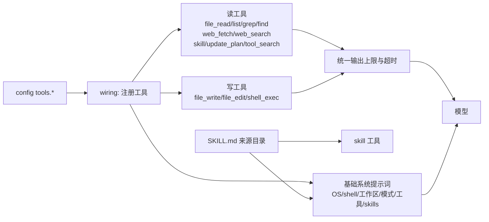

<!-- template_id: design; template_version: 1.1.1 -->
# 开发基础工具与 skills 跑通 设计

> 状态：Draft 0.1 / 待人工计划批准

## 修订记录

| 版本 | 日期 | 作者 | 摘要 |
|---|---|---|---|
| 0.1 | 2026-10-10 | Claude | 初稿 |

> 仅语义变化递增版本；纯 identity/provenance/元数据纠正沿用原版本，并在 Git/进度记录中留痕。

## 背景与目标

思考模式 RIGOROUS；核心目标：让 suag 在 chat、`run`（gofer 拉起）与 ACP 下都具备开发常用的基础工具，工具行为可预期、不挂住、输出有界，skills 真正可用，之后再交给 gofer 日常使用。scope freeze：下列 W1–W6；review budget：一轮合并轴评审（个人工具、未投产，低暴露度，SR1409）；停止条件：评审无 CORE_BLOCKING 且用户确认待确认项。

用户可见结果：

1. 模型能搜内容（`file_grep`）、按模式找文件（`file_find`）、按字符串精确修改（`file_edit`）、抓取网页正文（`web_fetch`），大文件按行分段读取。
2. `shell_exec` 在 Windows 上可用、超时一定生效、输出有上限并返回退出码。
3. 模型从第一轮就知道自己在什么系统、什么目录、有哪些工具、是只读还是可写；缺工具时得到可操作的提示而不是空转。
4. `~/.agents/skills` 等目录下的标准 SKILL.md 对模型可见、可按需加载正文。

## 名词

- **只读/写工具**：沿用现有分类；写工具只在 `--allow-write`（run）、`tools.allow_write`（chat）、ACP 非 read_only 时注册。
- **输出上限**：单次工具结果返回给模型的最大字符数，超出时保留头尾并注明省略量。
- **基础系统提示词**：每个会话固定的一段环境与工具说明，内容在会话内保持稳定以利于前缀缓存。

## 范围与非目标

范围：仓库 `inhere-tools/suag`——`internal/platform/tools/native/`、`internal/wiring/`（注册、提示词）、`internal/capability/skills/`、`internal/acpserver/policy.go`（新工具的读写分类）、MCP client（单次调用超时）、README 与 `docs/usage/`。

非目标：后台/常驻 shell、子 agent、向量检索式工具搜索、Claude 思考内容、gofer 侧配置改动（只在文档中给出建议，由 gofer 会话决定）、按 skill 自动收窄工具集。

## 已确认事实与规范

（R = 仓库根，N = `R/internal/platform/tools/native`；盘点于 2026-10-10，HEAD 749f73f。）

| 项 | 事实 |
|---|---|
| 现有工具 | `file_read`(path)、`file_list`(dir，单层)、`file_write`(整文件覆盖)、`shell_exec`(command，超时 30s 写死，`capabilities.go:49`)、`web_search`(SerpAPI，num 为 string)、`update_plan`、`tool_search`(仅存在 deferred MCP 时) |
| 注册条件 | 无写权限时只有 file_read/file_list/update_plan + MCP；`web_search` 也只在写模式且有 `serpapi_key` 时注册（`capabilities.go:45-53`） |
| 输出 | native 工具全部无上限（ReadAll/全量 Buffer），只在上下文超阈值时于构建阶段截断（`personal/context.go:209-221`） |
| shell | 固定 `sh -c`（`code_exec.go:50`），Windows 无 sh 即失败；超时只杀 sh，未设 `WaitDelay`/进程组，子进程持有管道时 `cmd.Run` 不返回 |
| 越界 | 文件工具先词法检查再 `os.OpenRoot`（`file.go:175-270`）；shell 只设 cwd |
| 提示词 | wiring 未设置 PromptBuilder，默认返回空串（`pkg/agentcore/runtime_helpers.go:362`） |
| 缺工具 | 调用未注册工具得到 "tool not found"，不计入拒绝次数（`registry.go:110-112`），最多跑满 100 步 |
| ACP 分类 | `policy.go:275-294` 已把 `web_fetch` 列为读类，但工具未实现；审批 `RequestPermission` 无超时 |
| MCP | `tools/call` 无单次超时（`mcp/client.go:362-363`） |
| skills | `buildDefaultSkillRegistry` 无非测试调用方，模型不可见；解析器按 `---` 切块逐块当 YAML，带正文的 SKILL.md 很可能被静默跳过；工具需求靠描述关键词猜测（`loader.go:86-107`） |
| gofer 使用 | gofer 侧 suag 只有联调期的几次 ping（2026-10-07）；`run` 模板未带 `--allow-write`，ACP 样例为 `permission_policy: ask`（默认等 1800s） |
| 规范 | SR1402.1（外部进程/网络/终端改动须真实验证）、SR1403、GR104（单文件≤1000 行）、GR106 |

## 总体方案

### W1 新增工具

| 工具 | 分类 | 参数 | 行为要点 |
|---|---|---|---|
| `file_grep` | 读 | `pattern`(RE2)、`path`、`glob`、`ignore_case`、`context`(0–5)、`output`(`content`/`files`/`count`)、`max_results`(默认 100，上限 1000) | 纯 Go 实现；遍历工作区，跳过 `.git`、`node_modules`、`vendor`、`dist` 等默认目录与根 `.gitignore` 中的简单模式；跳过二进制与 >1MB 文件；结果带 `path:line:`；受输出上限与 10s 超时约束 |
| `file_find` | 读 | `pattern`(支持 `**`)、`path`、`max_results`(默认 200) | 同样的忽略规则；按修改时间新→旧排序 |
| `file_edit` | 写 | `path`、`old_string`、`new_string`、`replace_all` | `old_string` 必须存在；不唯一且未设 `replace_all` 时报错并给出匹配次数；保留原换行风格；ACP/chat 审批展示 diff |
| `web_fetch` | 读 | `url`、`max_chars`(默认 20000) | 仅 http(s)；超时 20s；下载上限 5MB；HTML 去掉 script/style 后转为文本（保留标题、链接、代码块），其他文本类型原样；默认拒绝回环/私网/链路本地/云元数据地址（DNS 解析后与每次跳转都校验），`tools.web_fetch.allow_private: true` 可放开 |

### W2 改进现有工具

- `file_read`：加 `offset`/`limit`（按行，默认前 2000 行）、行号输出（`cat -n` 风格）、单次上限、二进制检测（报告类型与大小，不输出内容）。
- `file_list`：加 `depth`（默认 1，上限 5）与 `max_entries`（默认 500），沿用忽略规则，目录后缀 `/`。
- `shell_exec`：
  - Windows 默认用 PowerShell（`pwsh` 优先，否则 `powershell`），其他系统用 `sh -c`；`tools.shell`（如 `bash`、`cmd`）可覆盖；工具描述写明当前 shell。
  - `timeout` 参数（秒，默认 120，上限 `tools.shell_timeout_max` 默认 600）；超时后整组终止（Unix 进程组、Windows job object），并设 `WaitDelay` 保证返回。
  - 输出合并 stdout/stderr，超过上限时保留头尾；结果末尾附退出码；stdin 为空设备。
- `web_search`：`num` 改为 integer；作为读工具在只读模式也注册（仍需 `serpapi_key`）。
- 统一输出上限：所有 native 工具结果经同一截断函数（默认 30000 字符，`tools.max_output_chars` 可调），截断处注明省略量与继续读取的方法。

### W3 基础系统提示词

会话开始时生成一段稳定文本：OS 与 shell、工作区路径、当前模式（只读/可写，及开启写工具的方法）、可用工具一句话列表、skills 列表（W4）、工具使用约定（优先 `file_grep`/`file_find` 而不是 shell 搜索、大文件分段读、编辑前先读）。内容只依赖会话启动时的配置，同一会话内不变；调用未注册工具时返回“该工具未启用：<原因与开启方法>”，并计入拒绝次数，避免空转。

### W4 skills 跑通

- 解析：标准 SKILL.md = YAML frontmatter（`name`、`description`，可选 `allowed-tools`）+ Markdown 正文；无效文件记录警告并跳过，不再静默。
- 来源：沿用 `~/.agents/skills`、`<workspace>/.agents/skills`、`<workspace>/skills`；同名时工作区优先。
- 暴露：系统提示词列出每个 skill 的 `name — description`（截断到 160 字符）；新增读工具 `skill`（参数 `name`）返回正文与 skill 目录路径；skill 引用的同目录文件经 `skill` 的 `file` 参数读取（限制在该 skill 目录内，因 `file_read` 只允许工作区）。
- `allowed-tools` 只作信息展示，不自动收窄工具集（非目标）；删除按描述关键词猜测工具的旧逻辑。

### W5 不挂住

- MCP `tools/call` 单次超时（`mcp.call_timeout_sec`，默认 120）。
- shell 超时与输出上限见 W2；所有新工具受 ctx 超时约束。
- ACP 审批超时不在 suag 侧加（审批等待由 gofer 的 `permission_policy` 决定）；`docs/usage/gofer-personal-agent.md` 写明：日常任务用 `suag` run 模板加 `--allow-write` 或 ACP `permission_policy: auto_allow`，需要人工把关时用 ask 并在 web 端处理。具体 gofer 配置改动交 gofer 会话。

### W6 验证

- 每个新/改工具的单测（含 Windows 路径、二进制、越界、截断、超时、子进程持有管道、SSRF 拒绝、跳转到私网被拒）。
- `make smoke-chat` 增加一个用到 `file_grep`/`file_edit` 的场景。
- 真实验证（SR1402.1）：主机 Windows 上用真实 provider 跑一轮 chat 与一次 gofer `suag` job，完成“搜索→读→编辑→运行测试”的小任务，记录 trace。

## 架构

## 关键流程

- 修复一个 bug：模型 `file_grep` 定位 → `file_read` 带 offset 读相关段 → `file_edit` 精确替换 → `shell_exec` 跑 `go test`（超时 120s，输出截断附退出码）。
- 使用 skill：提示词列出 `gofer-usage — …` → 模型调用 `skill(name)` 取正文 → 按正文操作。
- 只读模式下要求改文件：模型调用 `file_edit` → 得到“未启用，需 --allow-write 或 tools.allow_write”的拒绝，计入拒绝次数，回合按现有规则结束。

## 安全、数据、运维与回滚

- 新增读工具都在工作区内（grep/find/read）或受 SSRF 规则约束（web_fetch）；`skill` 只读取已发现的 skill 目录内文件。
- `file_edit` 属写工具，走现有审批（chat ask、ACP RequestPermission）。
- shell 换 PowerShell 后命令语法不同，工具描述必须写明当前 shell，避免模型按 bash 语法写命令。
- 配置项均有默认值，旧配置无需修改；回滚为回退版本。

## 决策

- D1 grep/find 纯 Go 实现，不依赖外部 rg，保证单二进制可用。
- D2 web_fetch 默认拒绝内网地址，配置可放开。
- D3 Windows 默认 PowerShell，`tools.shell` 可覆盖。
- D4 skills 用 `skill` 工具取正文，不放开 `file_read` 的工作区限制。
- D5 统一输出上限与工具超时，所有 native 工具一致。
- D6 ACP 审批等待由 gofer 侧负责，suag 只完善文档。

## 待确认事项

- Q1 Windows 默认 shell：PowerShell（推荐，系统必有）／检测到 Git Bash 则用 bash，否则 PowerShell／cmd。
- Q2 web_fetch 的 HTML 转换：标准库 + `golang.org/x/net/html` 自写文本提取（推荐，依赖少）／引入 html→markdown 库（输出更好，多一个依赖）。
- Q3 gofer 中 `suag` run 是否默认可写：建议 gofer 的 suag 模板加 `--allow-write`（推荐，配合审批外的日常任务）／保持只读，需要写时用 ACP。此项由 gofer 会话落实。
- Q4 批次：W1–W6 一次做完（推荐）／先做 W2/W3/W5（不挂住、可预期），再做 W1/W4。

## 结论与人工计划 Gate

确认 Q1–Q4 并批准本设计后编写实施计划；计划经一轮合并评审与人工批准后实施。
