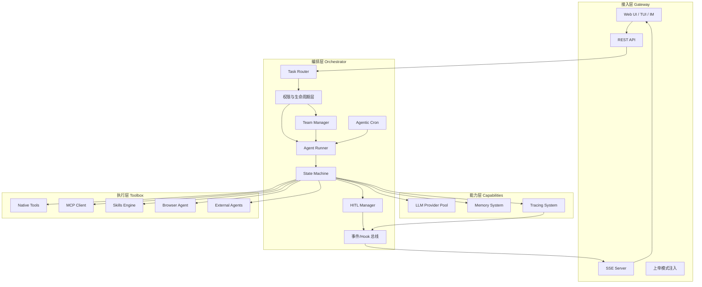

# axon 架构总纲

> 版本: v1.0 | 日期: 2026-03-16 | 状态: 设计稿

***

## 1. 项目定位

axon 是以 **Go 语言**构建的本地优先 AI Agent 编排引擎，定位是：

- **大脑入口**：统一接收用户任务，分解并分发给专家 Agent 团队
- **长期记忆**：通过 SQLite + 向量搜索实现跨会话记忆
- **团队编排**：动态组建专家团队，每个 Agent 有独立的角色定义（AGENTS.md, SOUL.md）
- **工具生态**：接入 Native Tools、MCP Server、Skills 脚本、Browser Agent
- **外部协作**：可调用 claude-code、opencode 等外部 AI 工具完成专项任务
- **最小人工干预**：只在关键决策节点触发 HITL（人机协作）

### 核心设计原则

| 原则      | 说明                                 |
| ------- | ---------------------------------- |
| 单一可执行文件 | 嵌入 SQLite，无外部依赖，开箱即用               |
| 接口驱动    | LLM、Memory、VectorStore 均面向接口，易于替换  |
| 上下文隔离   | Subagent 在独立会话运行，只向 Parent 返回结构化结果 |
| 全链路可观测  | 每个操作绑定 TraceID/SpanID，实时 SSE 推送    |
| 失败恢复    | 内置重试 + HITL 挂起机制，Agent 连续失败不崩溃     |

***

## 2. 分层架构图



***

## 3. 分层职责

| 层级                 | 核心组件                                           | 职责                                   |
| ------------------ | ---------------------------------------------- | ------------------------------------ |
| 接入层 (Gateway)      | REST API、SSE Server、WebUI                      | 协议适配、认证、"上帝模式"指令注入、实时事件推送            |
| 编排层 (Orchestrator) | Task Router、Team Manager、HITL Manager、权限层、事件总线 | 任务路由、团队管理、Agent 生命周期、HITL 挂起/恢复、权限治理 |
| 能力层 (Capabilities) | LLM Provider Pool、Memory System、Tracing System | LLM 调用、跨会话记忆、全链路追踪                   |
| 执行层 (Toolbox)      | Native/MCP/Skills/Browser/ExtAgent             | 工具执行沙箱、外部协议适配、脚本调度                   |

***

## 4. 模块索引

各模块详细设计分散在以下专项文档，本文档不重复细节：

| 文档                                            | 内容                                                          |
| --------------------------------------------- | ----------------------------------------------------------- |
| [Agent Core 设计](./01-agent-core.md)           | 12步递进式实现机制、ReAct Loop、状态机、会话生命周期(resume/fork)               |
| [Orchestrator 设计](./02-orchestrator.md)       | 任务路由、事件/Hook总线、权限与生命周期层                                     |
| [Team 协作设计](./03-team.md)                     | Team Manager、SOUL.md、任务分配、子Agent隔离                          |
| [Tools & Skills 设计](./04-tools-skills.md)     | Tool Registry、Native/MCP/Skills/Browser/ExtAgent、SKILL.md格式 |
| [Memory & Tracing 设计](./05-memory-tracing.md) | Memory System、向量检索、Tracing全链路                               |
| [Gateway & API 设计](./06-gateway-api.md)       | REST API、SSE推送、HITL、上帝模式、WebUI                              |
| [开发实施方案](./07-implementation-plan.md)         | 分阶段任务清单，用于开发跟踪进度                                            |

***

## 5. 项目目录结构

```
axon/
├── cmd/
│   ├── axon/          # 主程序入口 (CLI/TUI)
│   └── server/          # HTTP Server 模式
│
├── internal/
│   ├── agent/           # Agent 核心 (Runner、状态机、Soul 解析)
│   ├── team/            # 团队管理
│   ├── memory/          # 记忆系统 (InMemory + SQLite + VectorStore)
│   ├── llm/             # LLM Provider Pool
│   ├── tools/           # 工具系统 (native/mcp/skills/browser/external)
│   ├── tracing/         # 链路追踪
│   ├── hitl/            # HITL 管理
│   ├── cron/            # Agentic Cron
│   ├── gateway/         # 接入层 (HTTP Server、SSE、EventBus)
│   └── orchestrator/    # 编排层 (Router、权限层)
│
├── pkg/                 # 可对外暴露的包
├── web/                 # 前端资源 (go:embed 打包)
├── configs/             # 配置文件模板 + 默认 SOUL.md 模板
├── skills/              # 内置 SKILL.md 文件
├── go.mod
└── Makefile
```

***

## 6. 技术选型总览

| 类别        | 选型                              | 说明                                              |
| --------- | ------------------------------- | ----------------------------------------------- |
| 语言        | Go 1.22+                        | 原生并发，单二进制分发                                     |
| 数据库       | SQLite (modernc/sqlite)         | 零依赖，纯 Go，无 cgo，嵌入式                              |
| 向量搜索      | sqlite-vec                      | SQLite 扩展，ANN 搜索（Phase 2 引入，Phase 1 先用 BM25 兜底） |
| HTTP 框架   | net/http + chi router           | 轻量，标准库兼容                                        |
| 配置        | viper                           | 支持 YAML/环境变量                                    |
| 日志        | slog (标准库)                      | 结构化日志                                           |
| Embedding | 可配置：OpenAI / Ollama nomic-embed | 接口抽象                                            |
| MCP 协议    | 自实现 JSON-RPC over stdio         | 参考官方 spec                                       |
| 浏览器自动化    | chromedp                        | Go 原生                                           |
| 前端        | 嵌入式 SPA (Vue/React)             | go:embed 打包                                     |
| 测试        | testing + testify               | 标准                                              |
| 构建        | Makefile + goreleaser           | 跨平台构建                                           |

***

## 7. 数据流概览

```
用户请求 → TraceID生成 → Orchestrator分析
    → 权限层验证工具白名单
    → 是否需要团队？
        [是] → Team Manager创建专家组 → 各Agent领取子任务
        [否] → 单Agent直接执行
    → Agent ReAct Loop
        → Memory检索历史上下文
        → LLM推理（含Tool Schema）
        → 工具调用 → 结果写入Memory + Trace
        → 判断完成/继续/挂起(HITL)
    → 事件总线 → SSE推送 → 存储长期记忆
```

***

## 8. 风险与注意事项

| 风险                     | 等级 | 缓解策略                                |
| ---------------------- | -- | ----------------------------------- |
| sqlite-vec 跨平台兼容性      | 高  | Phase 1 先用 BM25 关键词搜索兜底，向量搜索作可选项    |
| LLM 上下文长度限制            | 中  | 强制摘要压缩 + subagent 隔离，控制单次请求 token   |
| 外部 Agent subprocess 超时 | 中  | 强制 timeout + goroutine 取消，避免僵尸进程    |
| SQLite 并发写性能           | 中  | WAL 模式 + 写操作串行化（单 writer goroutine） |
| Agent 无限循环             | 低  | maxSteps 硬限制 + token 预算限制           |

> 详细技术风险与待确认问题，见 [开发实施方案](./07-implementation-plan.md)。

